# 같은 구조, 세 가지 디자인

2026-11-09 · 디자인과 표현만 변경한다. 의류·시설·코디·도구의 정보 구조, 상세 순서,
필터·진행·수정·계산 동작은 유지한다.

**전환 위치: 도구 → 화면 → 디자인**

| 디자인 | 방향 |
|---|---|
| 현재 디자인 | 현재 사용 중인 차분한 로즈. 기존 사용자와 새 사용자의 기본값 |
| 아틀리에 | 아이보리 표면, 깊은 플럼 메뉴, 부드러운 곡선, 로즈 선택 상태 |
| 페이퍼 | 중립적인 종이 표면, 절제된 모서리, 선명한 구분선, 차분한 숫자 |

디자인은 라이트/다크/시스템 모드와 메인 색상을 함께 사용한다. 설정은 이 기기의
`fms-theme`에 저장되며, 다른 기기의 디자인이나 Firestore 진행 기록을 바꾸지 않는다.
디자인을 바꿀 때 화면을 다시 그리지 않아 검색·선택·펼친 상세와 진행 상태가 유지된다.

## 설정

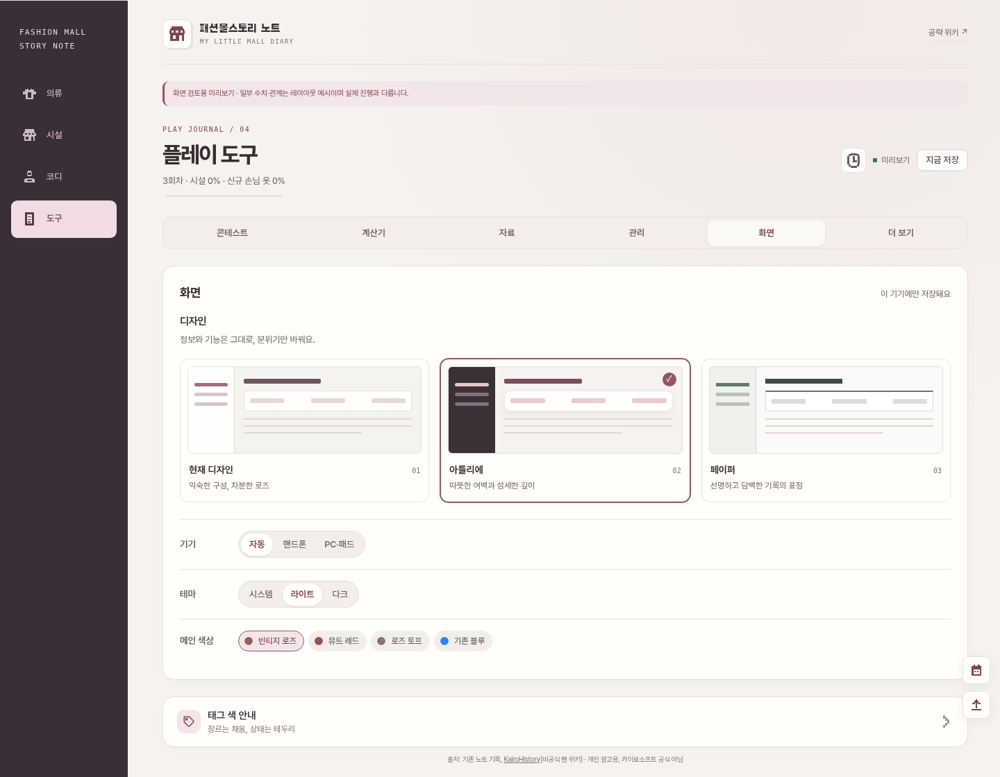

## 전체 화면

| 아틀리에 | 페이퍼 |
|---|---|
| 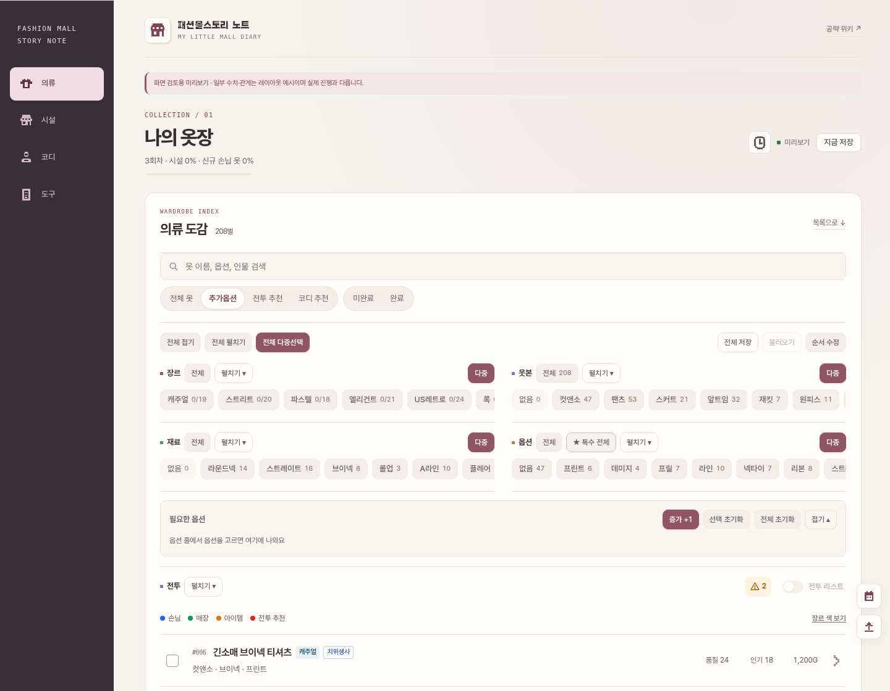 | 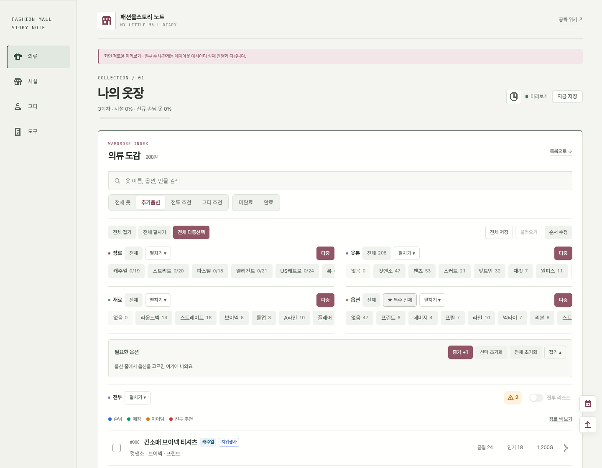 |

## 같은 상세, 다른 분위기

| 아틀리에 | 페이퍼 |
|---|---|
| 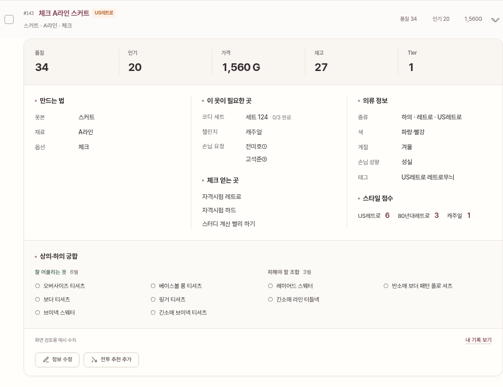 | 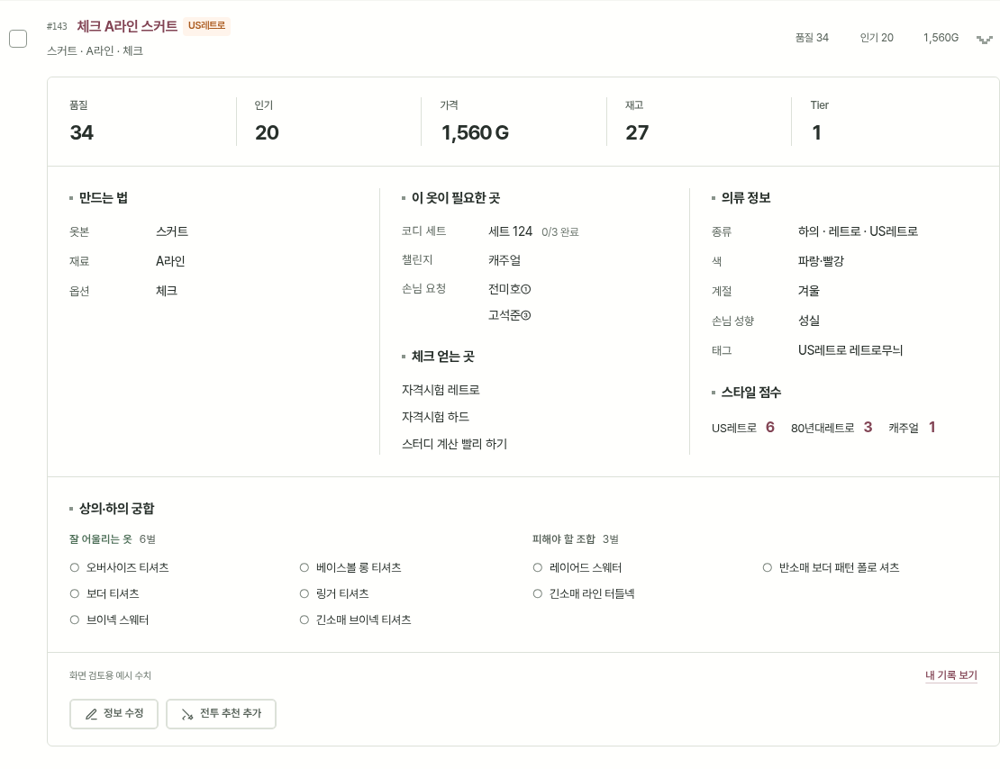 |

## 다크 모드

| 아틀리에 | 페이퍼 |
|---|---|
| 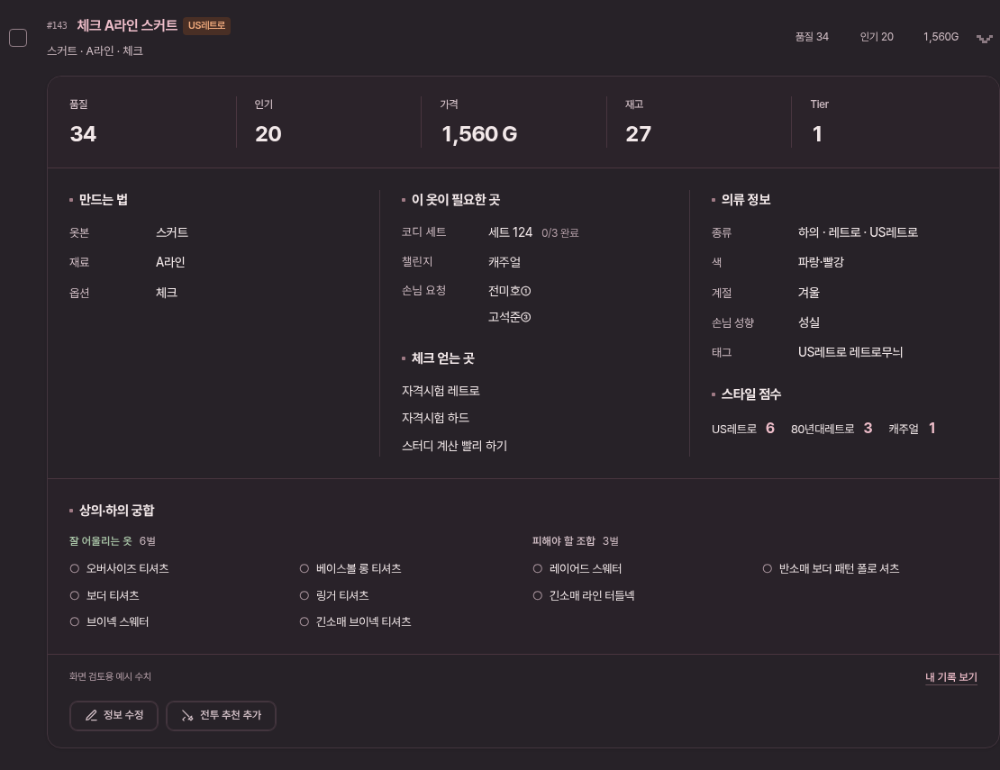 | 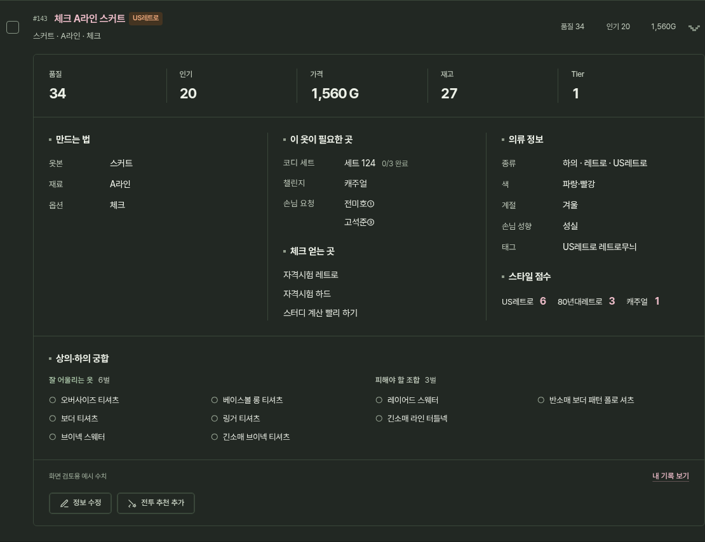 |

## 시설·코디·배틀

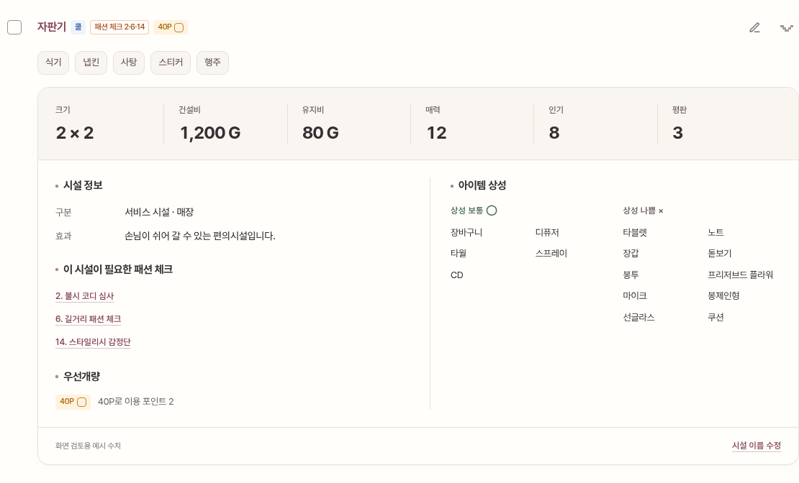

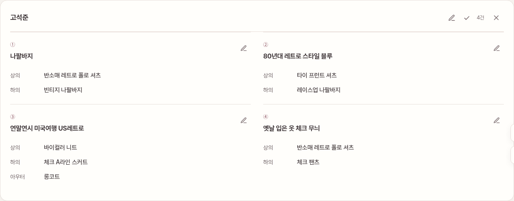

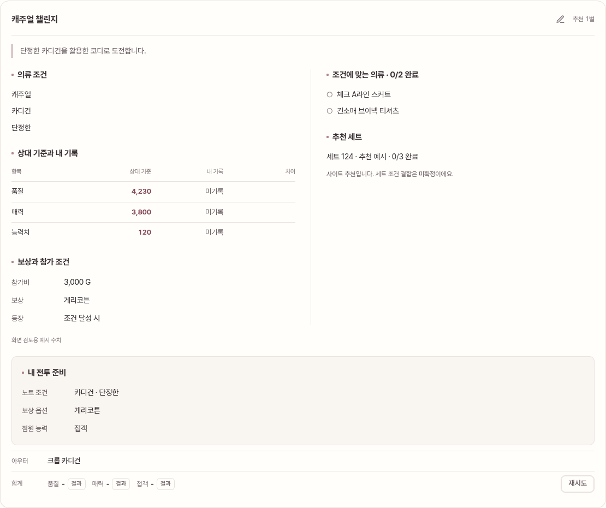

## 도구·편집창

| 콘테스트 | 정보 수정 |
|---|---|
| 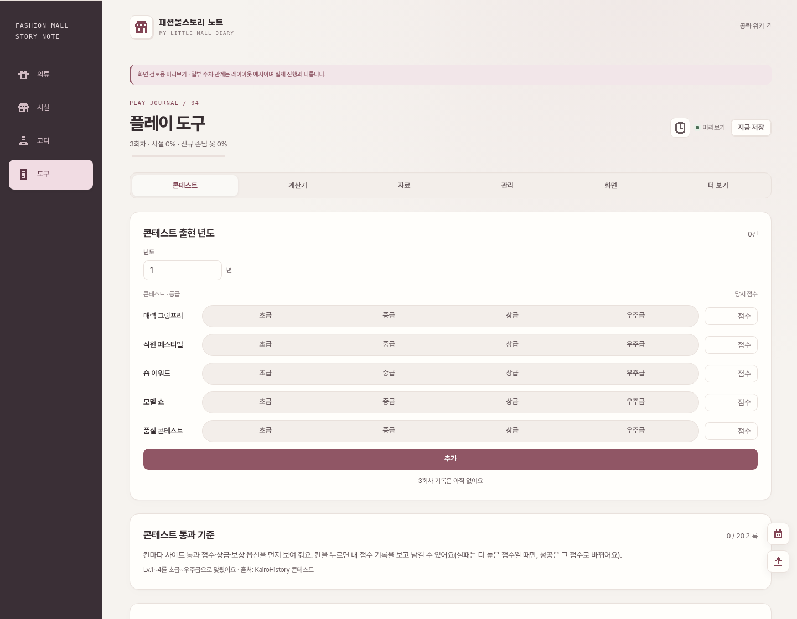 | 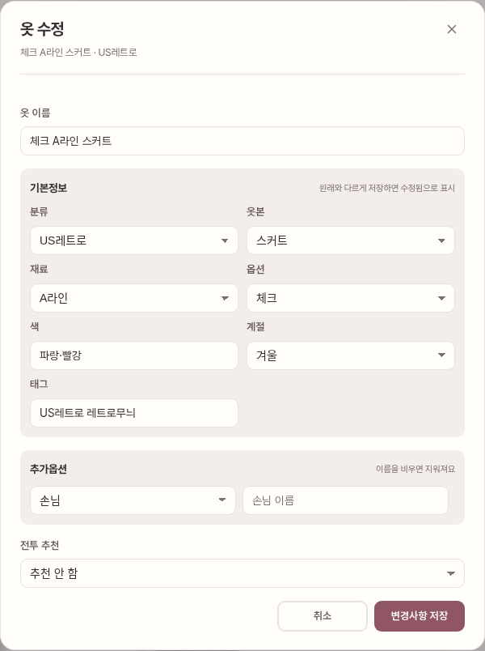 |

## 모바일

| 아틀리에 설정 | 페이퍼 설정 |
|---|---|
| 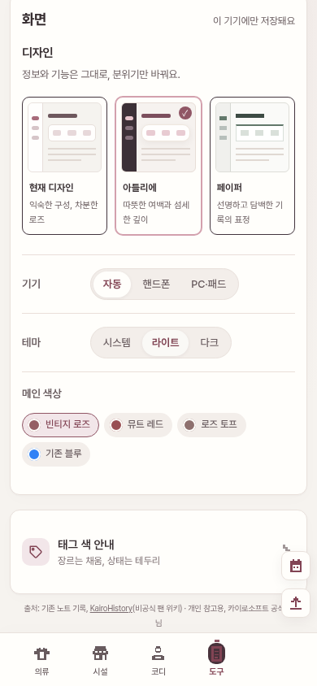 | 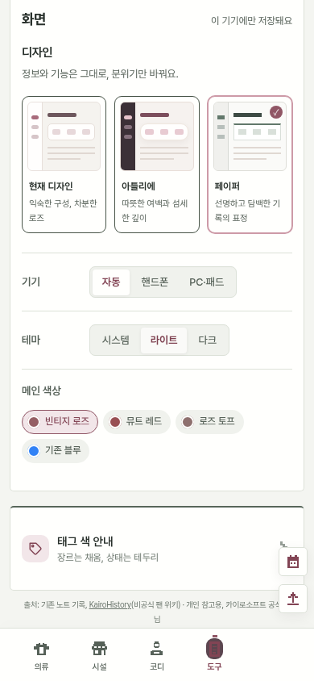 |

[아틀리에 모바일 상세](screenshots/appearance/atelier-mobile-detail.png) · [페이퍼 모바일 상세](screenshots/appearance/paper-mobile-detail.png)

이미지는 실제 구현을 미리보기 환경에서 캡처했다. 일부 수치·관계는 화면 검토용 예시이며
실제 진행 데이터가 아니다.

## 구현 경계와 검증

- `src/ui/appearance.ts`: 디자인 목록·선택 UI·초기 설정 복원·알 수 없는 값의 기본 처리.
- `src/styles/appearance.css`: `data-skin`으로 범위가 한정된 표면·색·타이포그래피·선택/초점 표현.
- 화면 엔진의 `data-design="hybrid"`는 유지한다. 시각 디자인은 `data-skin`으로만 분리한다.
- 기존 디자인은 새 스타일 선택자가 적용되지 않는다. 개인 설정에 `skin`이 없으면 기존 디자인이다.
- 디자인 전환은 클릭·키보드로 사용하고 `aria-pressed`로 선택 상태를 알린다.
- 모션 감소 설정을 따르고, 개별 의류 이미지나 추가 이미지 DB는 사용하지 않는다.
- 운영·미리보기 빌드, 디자인 저장/복원, 전환 시 진행·검색·상세 유지, 기존 기능을 검증한다.
- 새 디자인 각각의 320/390/768/1440px 목록·상세·편집·시설·코디·도구·다크 모드를 Chromium으로 확인한다.
- 실제 계정 로그인/동기화와 iPhone Safari 실기기 확인은 별도다.
