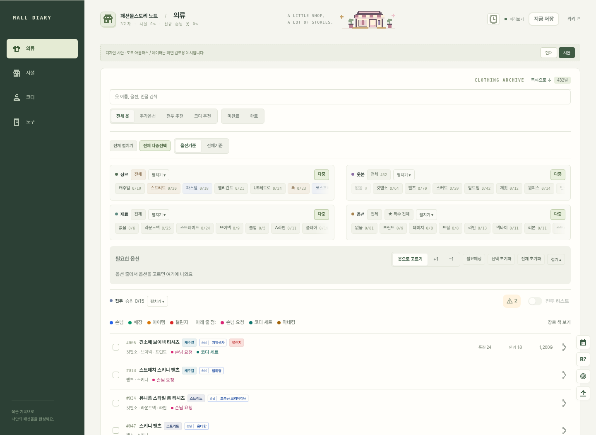
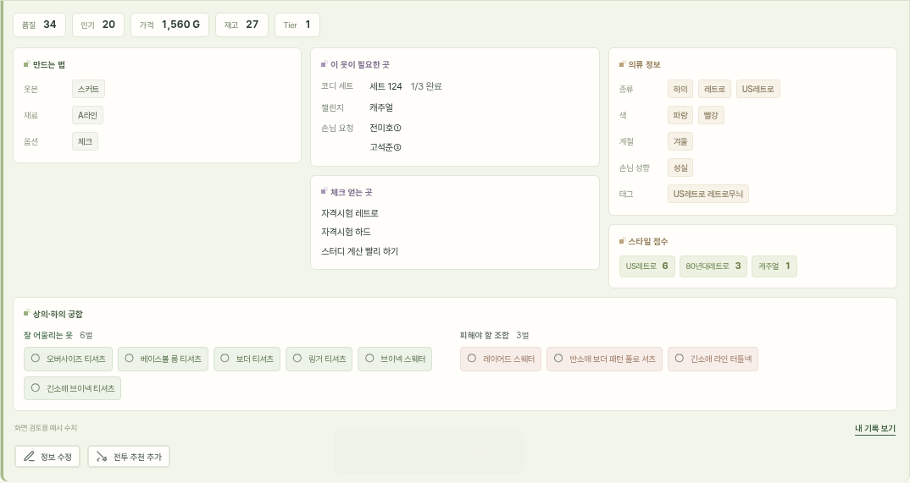
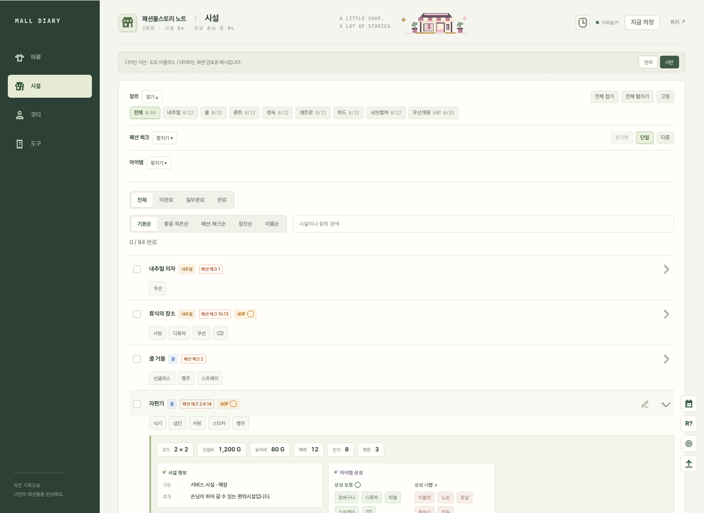
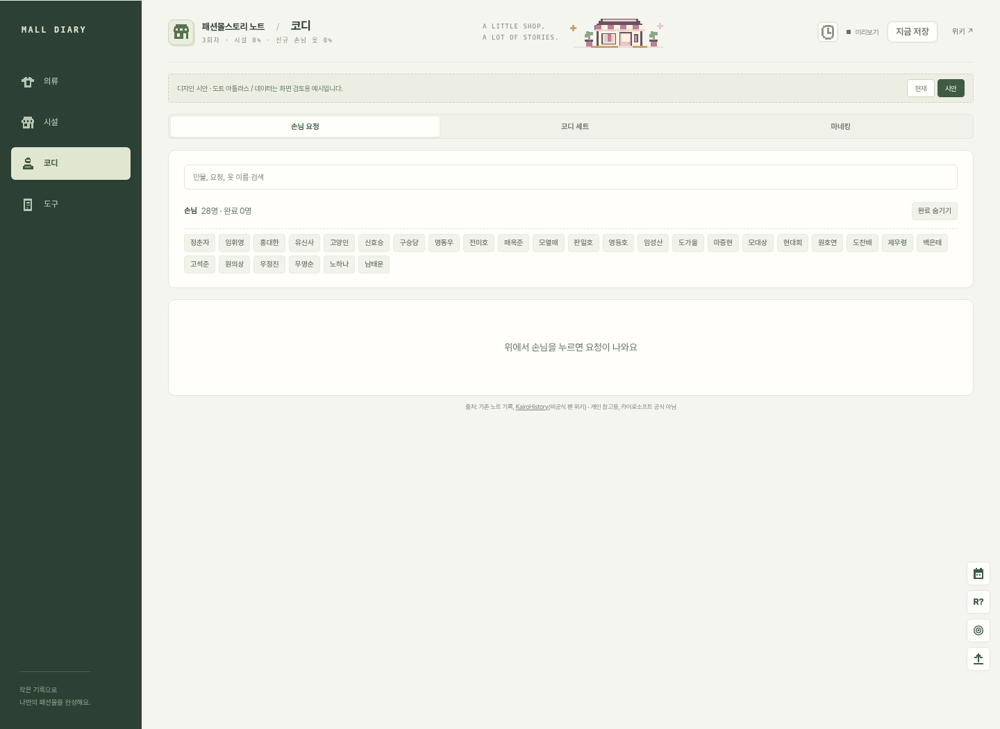
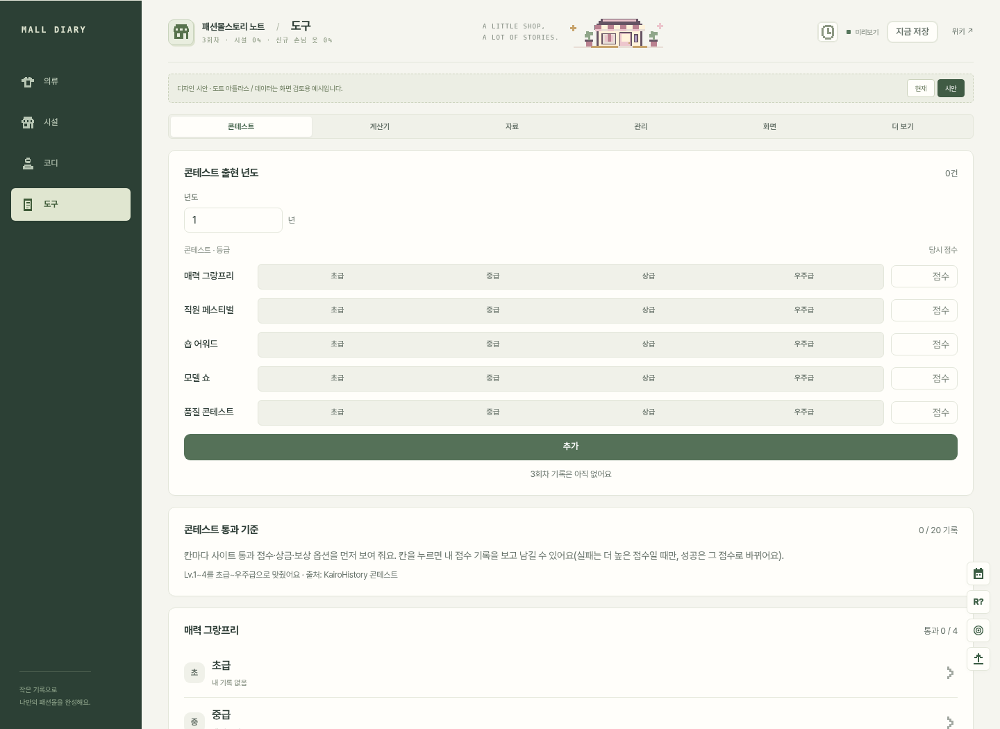
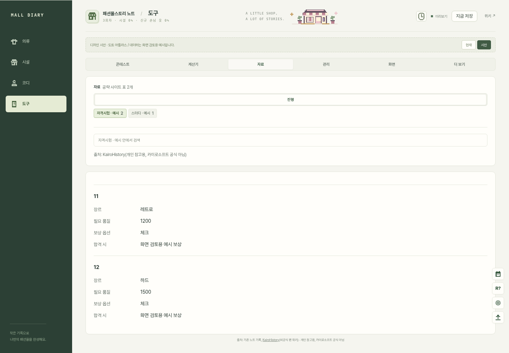
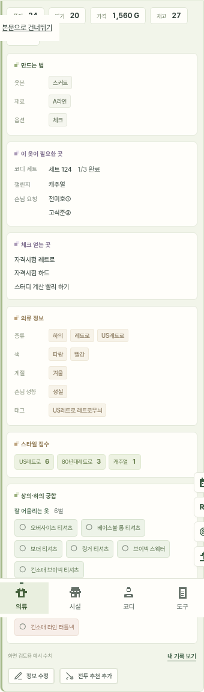

# 디자인 시안 · 도트 아틀라스

2026-11-10 · 최신 main `8c1c218`의 실제 화면 구조를 기준으로 만든 시안입니다. **운영 사이트에 적용하거나 배포하지 않았습니다.**

아이보리 종이 위에 올리브색 탐색 메뉴와 차분한 녹색·라벤더·살구색 태그를 더했습니다. 소장 노트의 차분함과 작은 게임 공방의 도트 감성을 함께 담았습니다.

## 전체 화면

## 상세 정보

작은 글씨와 촘촘한 태그를 쓰되, 만드는 법·필요한 곳·얻는 곳·기본 정보의 위계를 구분했습니다. 녹색은 상성 좋음, 살구색은 피해야 할 조합, 라벤더는 사용처 관련 제목입니다. 도트는 공통 아이콘과 가게 장면에 사용하며 의류별 이미지는 사용하지 않습니다.

[상세 전체 화면](studio-detail.png) · [현재 디자인의 같은 상세](current-detail.png)

## 시설 · 코디 · 도구 · 자료

## 모바일

[모바일 전체 화면](studio-mobile-390.png)

## 화면 비교하기

같은 폴더의 `index.html`은 캡처를 화면별로 전환하는 갤러리입니다. 파일 묶음을 내려받아 압축을 풀고 열면 로그인이나 서버 없이 볼 수 있습니다. 갤러리는 실제 앱 기능을 실행하지 않는 정적 디자인 검토 자료입니다.

실제 동작하는 앱 시안은 이 브랜치의 `app`에서 `npm ci` 후 `npm run dev:preview`로 실행합니다. 상단의 현재/시안 버튼으로 디자인을 전환할 수 있습니다. 운영 설정과 분리한 preview 모드 전용입니다.

## 범위와 검증

메뉴·필터·상세 순서·게임 계산·저장 구조를 유지했습니다. 작은 태그는 미리보기에서만 표현을 바꾸며, 원본 데이터를 수정하지 않습니다. 기본 데이터는 기존 공개 노트이고 일부 상세 수치·관계는 검토용 예시입니다. 로그인이나 사용자 계정 접근은 필요하지 않습니다.

- 미리보기 및 운영 빌드 성공.
- 320·390·768·1440px 의류 화면의 가로 넘침 확인.
- 의류·시설·코디·도구·자료 화면에서 브라우저 오류 없음.
- 디자인 전환 시 검색·진행 체크·열린 상세 및 내용 유지.
- 정보 수정창 열기와 취소 확인.

전체 운영 기능 회귀 테스트나 실제 계정 동기화 검증은 이번 디자인 시안의 범위에 포함하지 않았습니다.
