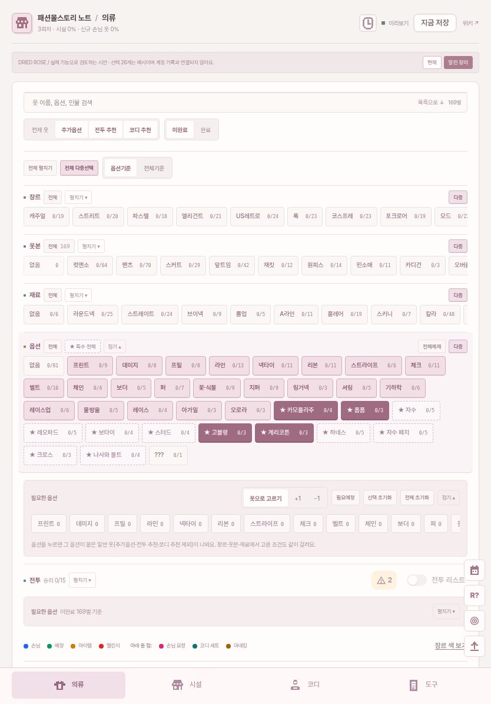
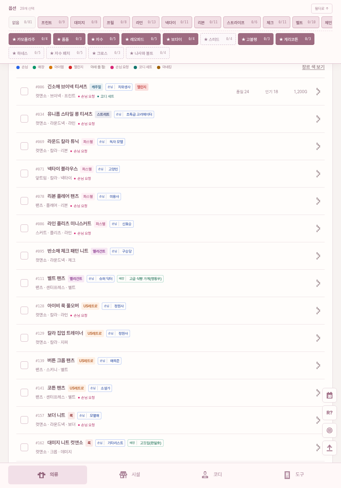
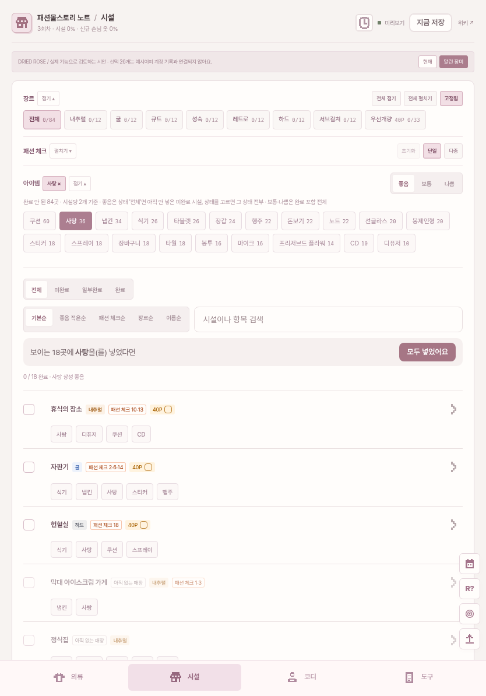
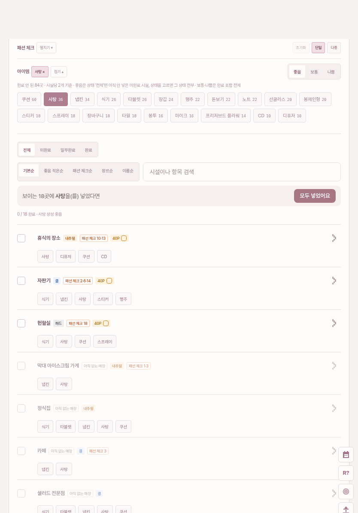
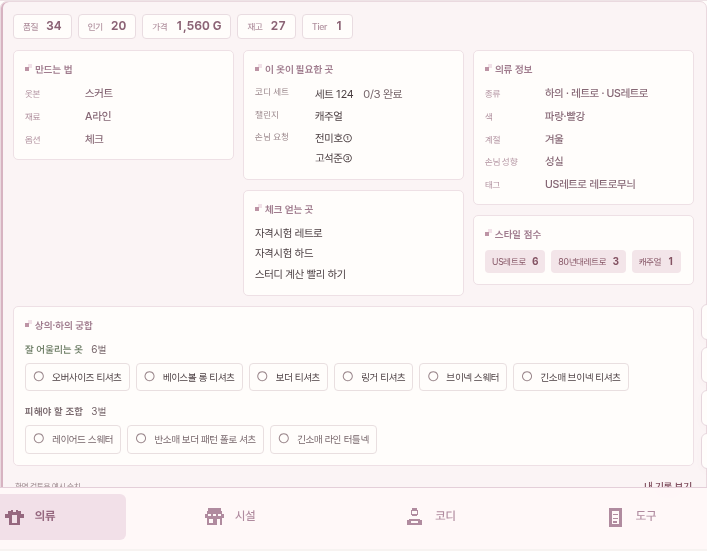

# 말린 장미 · 사용 기록을 먼저 반영한 디자인 시안

2026-11-10 · 기준 main `2b9c8eb` · 검토용 브랜치

의류 필터는 가끔 쓰는 검색창이 아니라 옷 체크와 번갈아 사용하는 작업 공간입니다. 클릭 기록과 반복해서 다듬은 커밋을 기준으로, 최신 앱의 실제 기능에 말린 장미 톤을 입혔습니다. **운영 사이트에는 아직 적용하지 않았습니다.**

## 직접 눌러 보기

파일 묶음을 내려받아 압축을 풀고 **`preview.html`**을 브라우저에서 열어 주세요. 실제 앱 엔진과 메모리 저장소가 들어 있습니다. 운영 계정과 연결되지 않으며 진행 데이터는 새로고침하면 초기화됩니다. 기본 선택 26개는 검토용 예시이며, 로그에서 사용자의 선택을 복원한 값이 아닙니다.

[동작형 시안 HTML](preview.html)

개발 서버에서는 `app`에서 `npm run dev:preview` 실행 후 `/fashion-mall-story-note/?rose=1`로 엽니다. 쿼리가 없는 일반 미리보기와 운영 시작 경로는 기존 상태를 유지합니다.

## 아이패드: 필터가 먼저

주 사용 폭 834px에 맞춰 메뉴를 아래로 두고 본문 폭을 확보했습니다. 장르·옷본·재료는 한 줄에서 바로 고르거나 기존 펼침 버튼으로 전체를 볼 수 있습니다. 가장 자주 쓰는 옵션은 펼쳐서 시작합니다. 보기 세 가지와 미완료 상태도 한 줄에 유지했습니다.

## 목록을 내려도 특수 옵션은 바로 누르기

일반 옵션은 옅은 로즈, 선택한 특수 옵션은 진한 말린 장미입니다. 일반 옵션을 다수 선택한 채 자수·보타이·레오파드 등을 하나씩 바꿀 수 있습니다. 원래 옵션 줄을 지나면 상단 작업 줄이 나타납니다. 일반 옵션은 가로로 탐색하고, 특수 옵션은 전부 보이도록 나눴습니다.

칩은 원본과 같은 엔진의 이벤트를 사용해 선택·저장·카운트가 같이 바뀝니다. 선택 여부에 따라 글자 굵기와 숫자 자리 폭이 바뀌지 않게 했고, 원래 필터와 작업 줄의 가로 스크롤도 보존합니다.

## 시설: 아이템 선택 → 체크 한 번 → 다음 아이템

전체·우선개량, 패션 체크 번호, 아이템 칩을 기존 위치에서 사용합니다. 선택한 아이템의 체크 동작과 되돌리기는 최신 엔진 그대로입니다. 목록에서는 아이템 작업 줄이 남고, 작업 줄의 아이템 순서는 체크 후에도 유지됩니다. 패션 체크 번호를 하나 골랐다면 이전·다음 이동도 작업 줄에서 할 수 있습니다.

## 상세는 행 아래에, 넓은 목록은 그대로

이전 결정과 커밋에 맞춰 오른쪽 상세 칸이나 아래에서 올라오는 새 패널 대신 기존 인라인 상세를 사용합니다. 정보 수정·코디 추천·배틀·직원 목표치는 실제 엔진의 기능입니다. 큰 장면 대신 공통 도트 아이콘을 사용해 작업 공간을 확보했습니다.

[넓은 화면](06-desktop.png) · [휴대폰](07-phone.png)

[직원 목표치](08-staff-goals.png) · [배틀 상세](09-battle.png) · [패션 체크](10-fashion-check.png) · [코디 상세](11-coord.png)

## 기록과 커밋을 어떻게 반영했는가

첨부 로그 503묶음의 1,111개 이벤트 중 클릭 830개를 확인했습니다. 아래 숫자는 클릭 직전 탭 기준입니다. 개인 원본·세션 식별자·기기 문자열은 이 자료나 저장소에 포함하지 않습니다.

| 확인한 사용 | 디자인 결정 |
|---|---|
| 의류 470회 · 시설 257회 | 두 작업의 필터와 체크를 최우선 배치 |
| 클릭 830회 중 폭 834px 823회 | 아이패드 세로 폭을 먼저 설계 |
| 옷 체크 95회 · 옵션 89회 | 목록 체크와 옵션을 같은 화면에서 반복 사용 |
| 배틀 칩 42회 | 의류 필터의 배틀 줄과 목표치 빠른 보기 유지 |
| 아이템 선택 49회 · 넣기 75회 | 기존 한 번 체크 동작과 다음 아이템 선택 연결 |
| 패션 체크 번호 28회 | 기존 번호판·이전/다음 이동 유지 |
| 의류 ↔ 코디 왕복 54회 | 코디 조건·추천 옷을 없애거나 별도 재구현하지 않음 |

반영 기준으로 특히 확인한 커밋은 `ee85e9f`(해금 순서), `ad8e655`(보상과 필터 연계), `bd50bd8`(한 번 체크), `6317018`(시설 정렬), `464f46f`(접힘·스크롤), `2b99844`·`2ab94b7`(직원 목표치), `084da12`·`4c3ab3f`(작은 헤더), `bc033ff`(추천 옷 조건 검사)입니다. 커밋 횟수를 사용 빈도의 실측값으로 취급하지 않고, 사용자가 설명한 중요도와 클릭 기록을 함께 반영했습니다.

`464f46f`에는 재접속 시 같은 탭의 위치를 복원하는 코드가 있었지만, 현재 탭 클릭 경로는 맨 위로 이동했습니다. 이번 검토 화면에서는 탭별 왕복 위치도 기억하도록 보강했고, 복원할 때 페이지 전체가 천천히 이동하지 않도록 즉시 복원합니다.

## 검증과 남아 있는 확인

- 기존 기능과 새 검증을 합친 29개 검사가 통과했습니다. 탭 왕복 보강 뒤 관련 8개, 즉시 복원 마감 뒤 핵심 2개를 추가 확인했습니다.
- 390·768·834·1194·1440px에서 의류·시설·코디·도구의 가로 넘침이 없습니다. 기존 320px 기능 검사도 통과했습니다.
- 다중 선택 유지, 특수 옵션 개별 토글, 작업 줄과 원본 동기화, 칩 위치, 의류 완료, 시설 아이템 한 번 체크, 패션 체크 이전·다음, 인라인 상세·편집창·직원 목표치·디자인 전환을 확인했습니다.
- 단일 HTML에서도 실제 엔진의 선택, 필터 가로 스크롤, 탭 왕복 위치, 아이템 체크·변경을 확인했습니다. 기록: `offline-verification.json`.
- 이번 시안은 라이트 화면의 색과 작업 흐름 검토입니다. 실제 계정 동기화·iPad Safari 실기기·새 디자인의 다크 모드까지 검증한 배포 완성본은 아닙니다.
- '빈 곳' 이벤트는 29개(의류 19·시설 8·코디 1·기록 1)입니다. 대상 요소나 클릭 좌표가 없어 정확한 위치는 확정할 수 없습니다. 의류↔코디 왕복 감소와 이 문제의 개선 여부는 새 사용 기록으로 확인해야 합니다.

자료 출처: 기존 노트와 [KairoHistory](https://kairo.waterbeetles.dev/ko/fashion-mall-story/). 일부 상세 값·관계는 기존 preview fixture의 검토용 예시입니다. 카이로소프트 공식 서비스가 아닌 개인 참고용 시안입니다.
