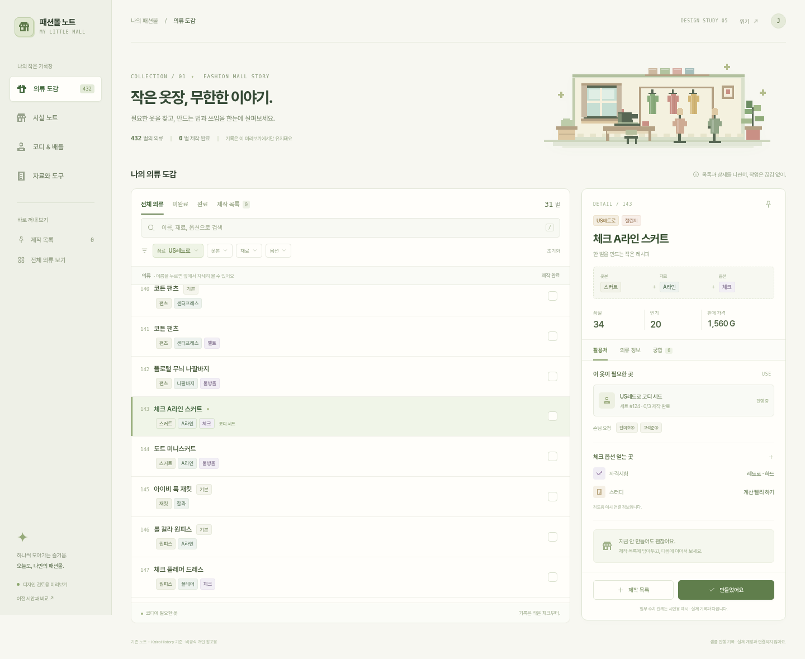
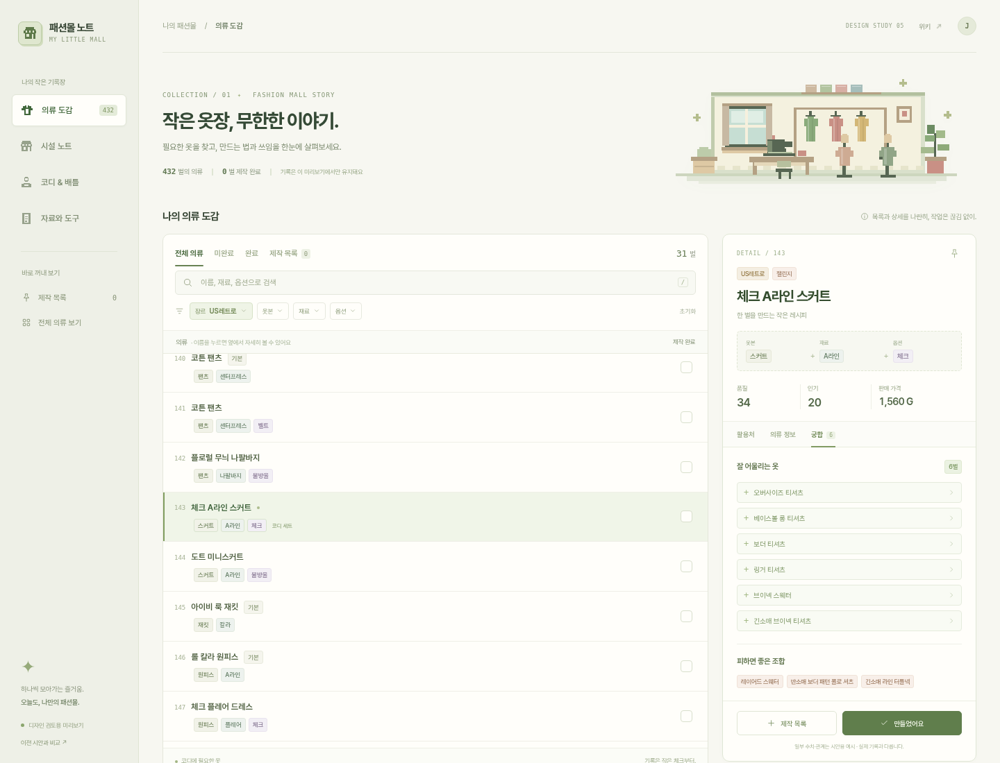
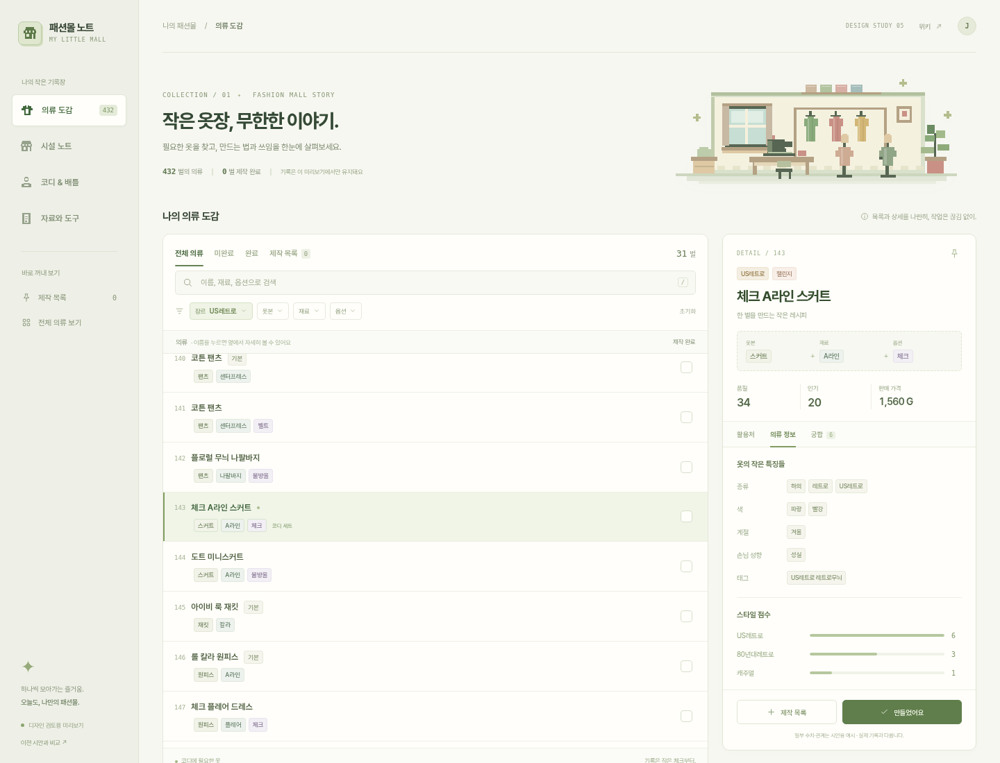
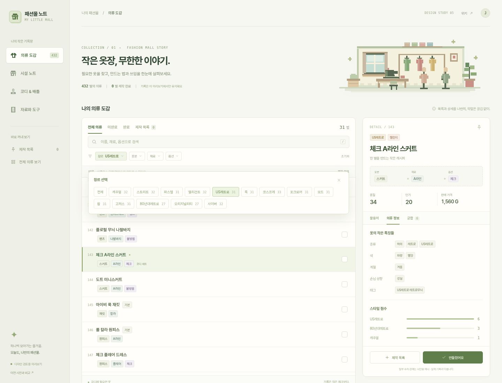
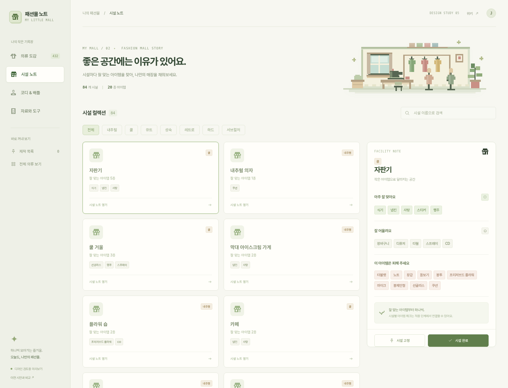
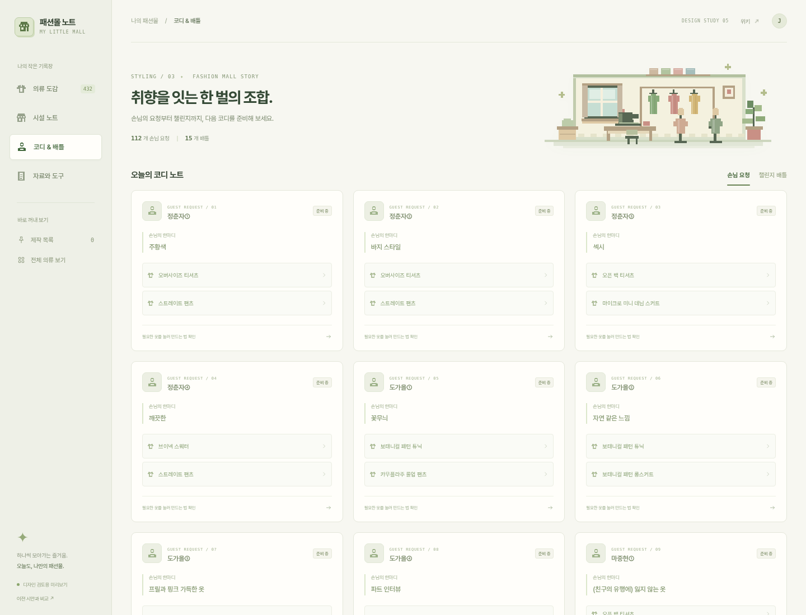
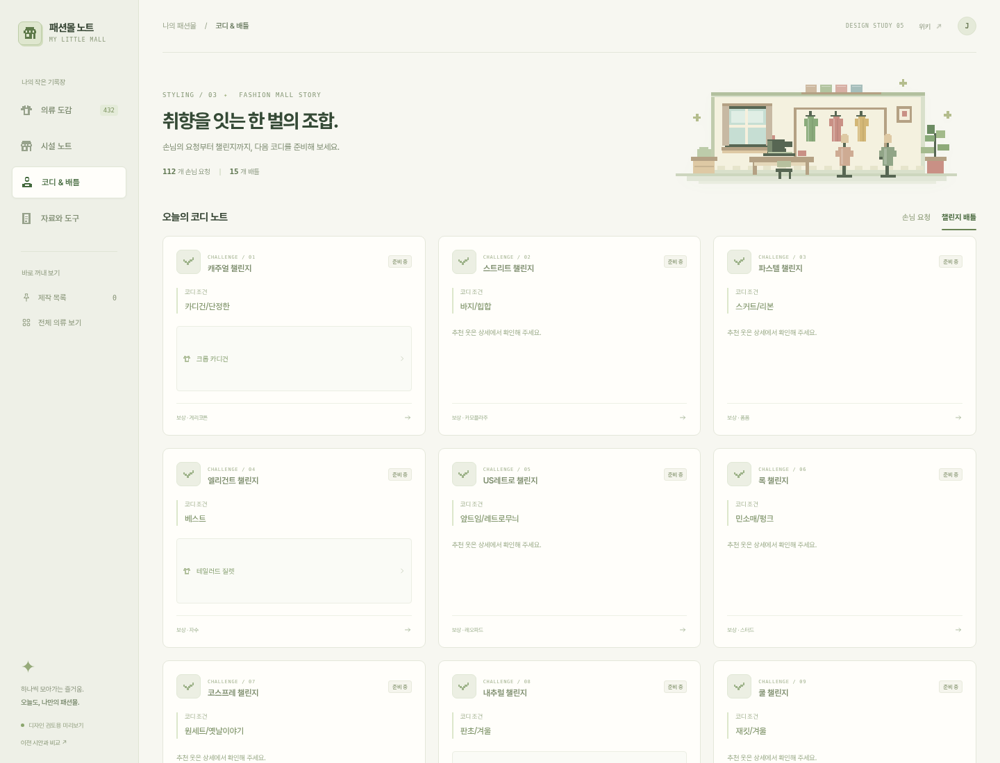
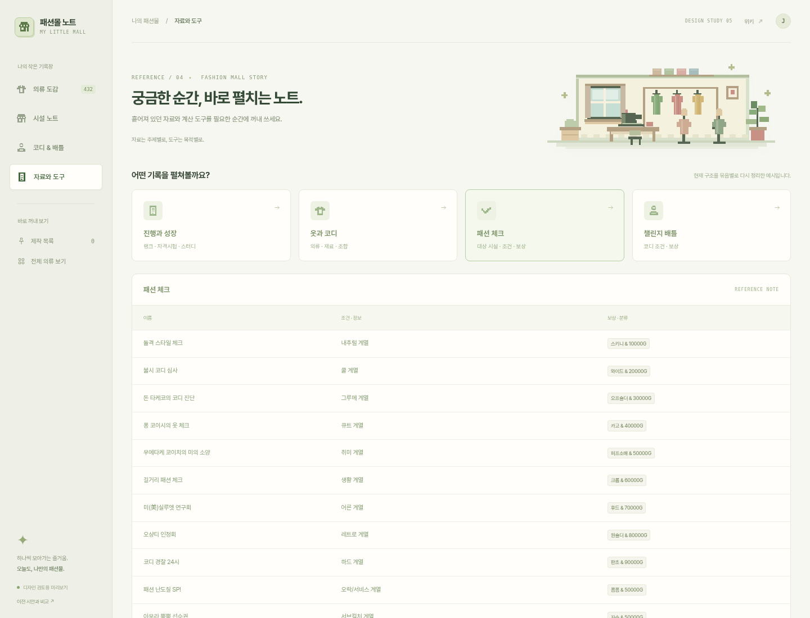
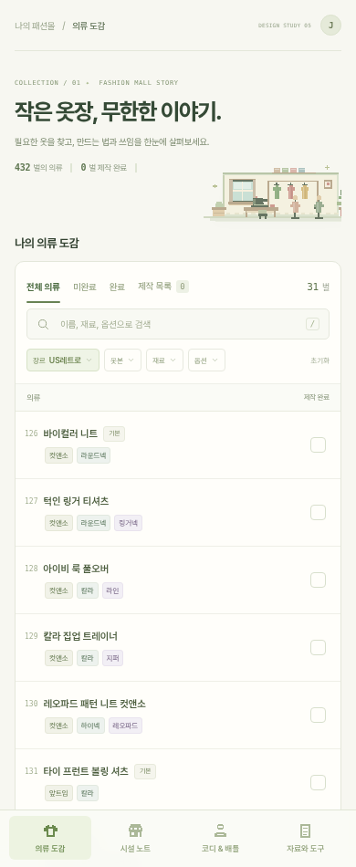
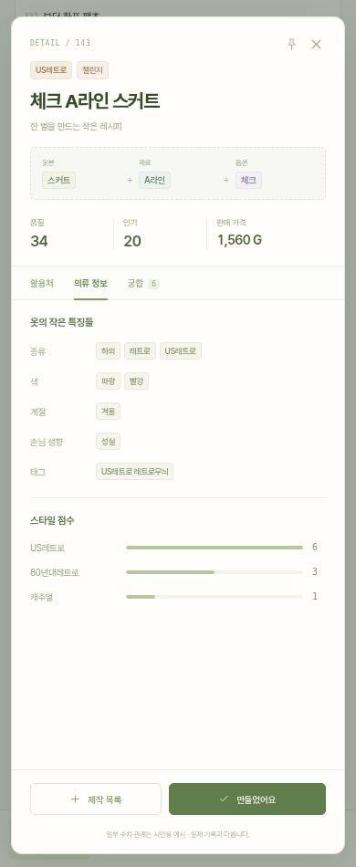

# 작은 공방 · 구조부터 다시 설계한 시안

2026-11-10 · Design study 05

이전 시안이 같은 화면의 표면을 다듬었다면, 이번에는 **탐색과 작업 흐름을 다시 설계**했습니다. 기존의 기능 구조를 이해하기 위한 기준은 최신 main `8c1c218`입니다. 운영 사이트에 적용하지 않은 별도 프로토타입입니다.

## 직접 사용해 보기

파일 묶음을 내려받아 압축을 푼 뒤 **`preview.html`을 열어 주세요.** CSS·스크립트·도트 그림·샘플 데이터가 한 파일에 들어 있어 서버·로그인·인터넷 연결 없이 사용할 수 있습니다. 다운로드한 HTML은 브라우저에서 열면 됩니다. 운영 계정이나 Firestore와 연결되지 않으며, 체크와 제작 목록은 새로고침하면 초기화됩니다.

[동작형 시안 HTML](preview.html)

## 의류: 왼쪽 목록, 오른쪽 작업 공간

필터를 펼치기 전부터 수많은 칩을 보여 주던 구성을 없애고, 검색과 네 가지 필터만 남겼습니다. 상세를 열어도 목록은 밀려나지 않습니다. 만드는 법·주요 수치는 상세 상단에 유지하고, 활용처·특징·궁합을 탭으로 탐색합니다.

## 시설: 공간과 아이템의 관계가 먼저

시설을 카드로 비교하고, 오른쪽에서 아주 잘 맞는 아이템·잘 어울리는 아이템·피할 아이템을 한눈에 봅니다.

## 코디와 배틀: 조건과 필요한 옷을 묶어서

손님 요청은 개별 카드로, 조건과 옷 조합을 함께 읽도록 했습니다. 연결된 옷을 누르면 의류 도감으로 이동합니다.

## 자료: 필요한 주제부터 고르기

자료는 주제별 진입점과 표로 구성했습니다. 주제 전환에 따라 표가 바뀝니다. 실제 프로젝트에 있는 모든 자료를 옮긴 상태는 아닙니다.

## 모바일: 목록은 그대로, 상세는 별도 패널

## 새로 그린 도트 공방

재봉틀·옷걸이·마네킹·의자·창문·화분을 그린 직접 제작 SVG입니다. 의류 개별 이미지는 없으며, 그림을 위한 DB 추가나 이미지 수집도 필요 없습니다.

## 검토 가능한 동작

의류 검색·장르/옷본/재료/옵션 필터·필터 초기화·미완료/완료/제작 목록 전환·제작 체크·목록 담기·상세 탭·연관 의류 이동, 시설 장르/검색/선택/완료 체크, 손님 요청과 배틀 전환, 자료 주제 전환을 시험할 수 있습니다. 모바일에서는 의류와 시설 상세가 패널로 열리고, 닫기 버튼과 Escape 키를 지원합니다.

432벌 의류·84개 시설·112개 손님 요청·15개 배틀의 기존 공개 노트 데이터를 바탕으로 만들었습니다. 일부 상세 수치·관계는 기존 preview fixture의 검토용 예시입니다. 실제 사용자의 진행 기록을 가져오거나 변경하지 않습니다.

## 구현 범위와 검증

- 새로운 구성의 디자인 프로토타입입니다. 기존 앱의 편집·동기화·계산기 등 모든 기능을 이 구조로 이전한 완성본은 아닙니다.
- `app/workbench.html`, `app/src/workbench/`로 분리했습니다. 기존 앱과 이전 디자인 시안은 유지합니다.
- 미리보기 빌드에서만 새 진입점을 추가하며 운영 빌드는 기존 진입점을 사용합니다.
- `npm run dev:preview` 후 `/fashion-mall-story-note/workbench.html`에서 원본을 실행할 수 있습니다.
- TypeScript·미리보기 빌드·운영 빌드를 확인했습니다.
- 320·390·768·1024·1440px의 의류·시설·코디·자료 화면에서 가로 넘침과 브라우저 오류가 없었습니다.
- 서버 없이 단일 HTML을 실행해 검색·필터·제작 체크·목록 담기·자료 전환·모바일 패널 동작을 검증했습니다.

검증 기록: `visual-check.json`, `interaction-check.json`.

자료 출처: 기존 노트와 [KairoHistory](https://kairo.waterbeetles.dev/ko/fashion-mall-story/). 카이로소프트 공식 서비스가 아닌 개인 참고용 디자인 시안입니다.
