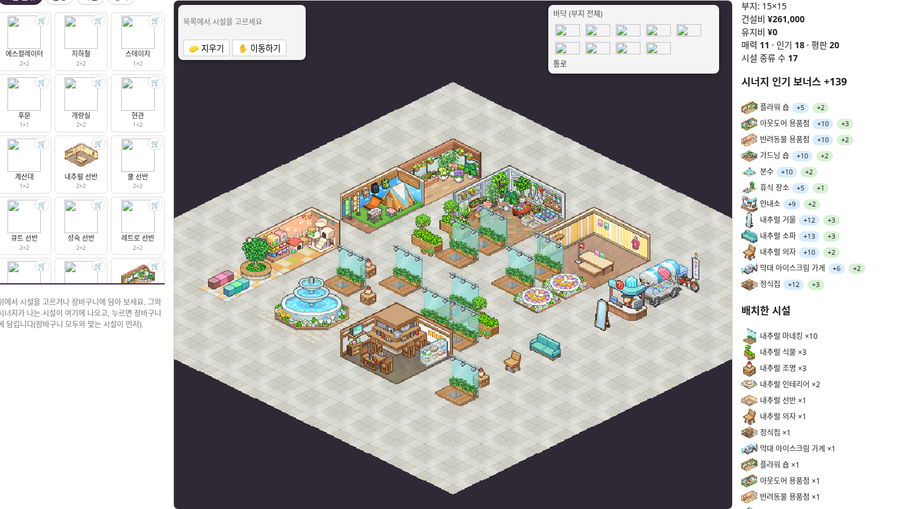

# 내추럴 마네킹 총 10개 · 9×9

기존 내추럴 기본 시설 17종에 마네킹 9개를 추가해 **마네킹 총 10개**로 만들었습니다. 나머지 추가 5칸은 식물 2개·조명 2개·인테리어 1개입니다.

기존 세 안과 같은 통로 구조를 유지했습니다. 시설 31개, 점유 48칸, 연결된 통로 33칸이며, 모든 시설이 외곽으로 연결된 통로에 면합니다. 빌더의 15×15 대지 중앙 9×9에 배치되어 있습니다.

빌더에서 `04-ten-mannequins.json`을 가져온 뒤 저장 목록에서 불러오세요. 기존 세 안과 다른 이름으로 저장됩니다.

실제 빌더 가져오기·불러오기·재내보내기 검증 완료. 시너지 **+139**, 기본 인기 포함 합계 **157**입니다. 정돈된 기존 골격 안에서 위치를 비교한 안이며 전역 최적해는 아닙니다. 빌더 데이터상 마네킹은 방문 시설이나 장식 인기 보너스 시설로 계산되지 않습니다.

출처: [KairoHistory](https://kairo.waterbeetles.dev/ko/fashion-mall-story/layout). 게임 그래픽 권리: Kairosoft 등 원권리자.
