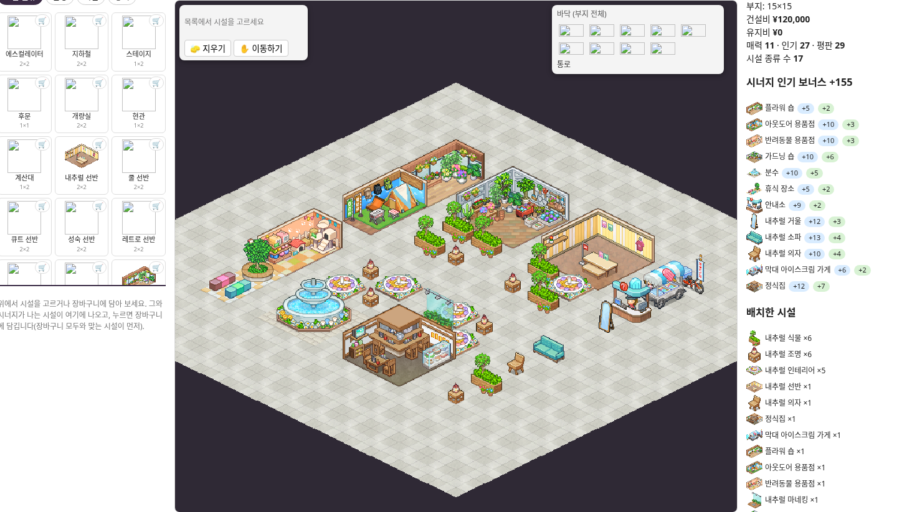
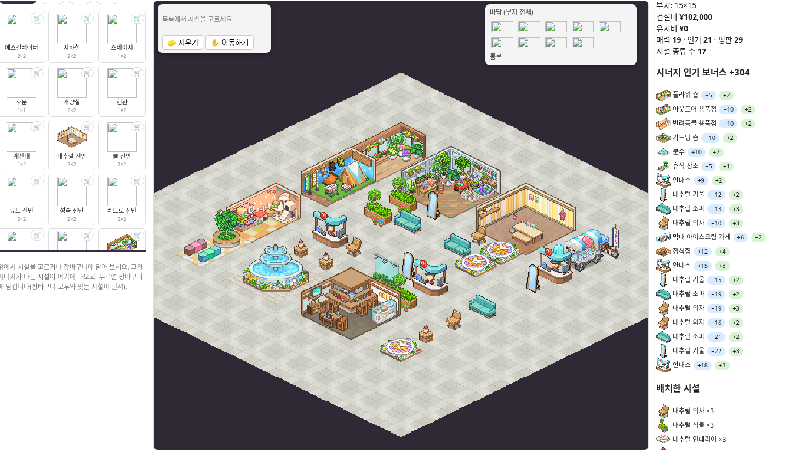
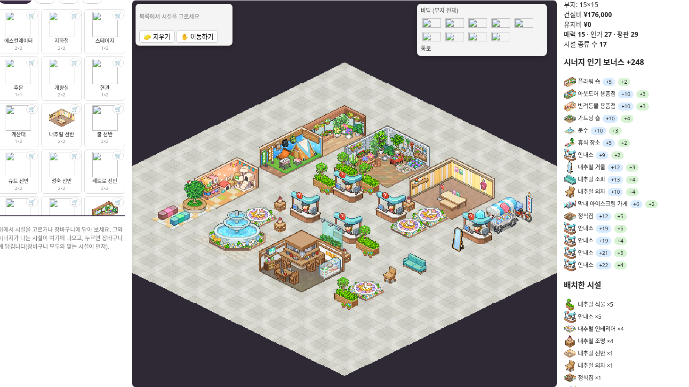

# 내추럴 9×9 배치 비교안

최고 점수보다 정돈된 통로와 보기 좋은 배치를 우선한 세 가지 비교안입니다. 내추럴 장르의 기본 시설 17종을 하나씩 포함하고, 추가 14칸의 구성만 바꿨습니다.

## 가져오기

1. 아래 파일들을 내려받아 압축을 풉니다.
2. [가게 배치 빌더](https://kairo.waterbeetles.dev/ko/fashion-mall-story/layout)에서 **가져오기**를 누릅니다.
3. `natural-9x9-all-three.json`을 선택합니다. 세 안이 저장 목록에 함께 추가됩니다.
4. 원하는 비교안의 **불러오기**를 누릅니다.

개별 JSON은 한 안만 가져올 때 사용합니다. 같은 이름의 저장은 빌더에서 갱신될 수 있으므로 기존 작업은 먼저 내보내기로 보관해 주세요.

## 구성과 점수

| 비교안 | 추가 시설 14개 | 안내소 총수 | 시너지 | 기본 인기 포함 합계 |
|---|---|---:|---:|---:|
| 정원형 | 식물 5 · 조명 5 · 인테리어 4 | 1 | +155 | 182 |
| 혼합형 | 안내소·거울·소파·의자 각 2, 식물·조명·인테리어 각 2 | 3 | +304 | 325 |
| 안내소 5개형 | 안내소 4 · 식물 4 · 조명 3 · 인테리어 3 | 5 | +248 | 275 |

안내소 5개는 기존 기본 시설의 안내소 1개를 포함한 수입니다. 시너지는 실제 빌더 화면에서 확인했으며, 합계는 기본 인기와 시너지를 합산한 비교값입니다. 게임 내 실측이나 전역 최적해를 의미하지 않습니다.

모든 안은 시설 31개, 점유 48칸, 빈 통로 33칸입니다. 가로 통로 3줄과 가운데 세로 통로를 연결했으며, 모든 시설이 외곽으로 연결된 빈 통로에 적어도 한 면을 접합니다. 장식 시설까지 동일하게 접근성을 검사했습니다.

빌더 가져오기 형식에는 사용자 지정 9×9 대지 설정이 없어 **15×15 대지 중앙의 9×9 영역**에 배치했습니다. 주변의 빈 여백은 9×9 계산에 포함하지 않았습니다. 화면에서 대지가 크게 보이는 것은 정상입니다.

## 실제 빌더 미리보기

### 1. 정원형

### 2. 혼합형

### 3. 안내소 총 5개형

## 검증 및 출처

실제 빌더의 파일 가져오기 → 세 안 각각 불러오기 → 시너지 확인 → 다시 내보내기까지 검사했습니다. 내보낸 데이터는 원본과 동일했습니다. 검증 기록은 `import-test.json`에 있습니다.

배치 형식·시설 데이터·미리보기: [KairoHistory 패션몰 스토리](https://kairo.waterbeetles.dev/ko/fashion-mall-story/). 게임과 그래픽의 권리는 Kairosoft 등 원권리자에게 있습니다. 비공식 배치 비교 자료입니다.
