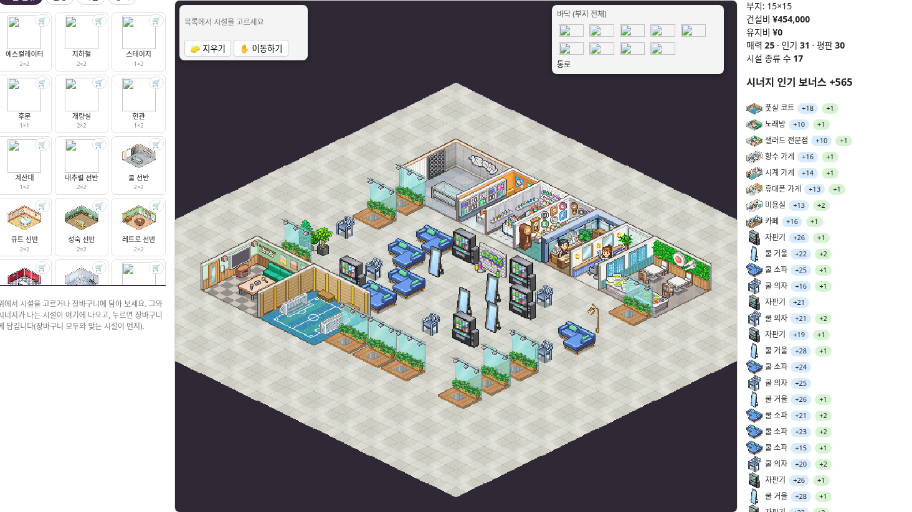
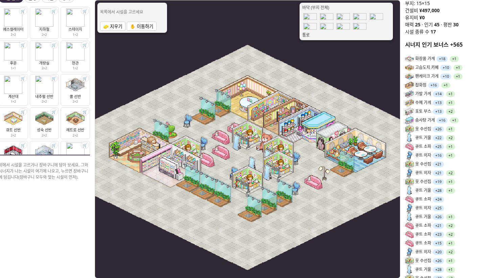
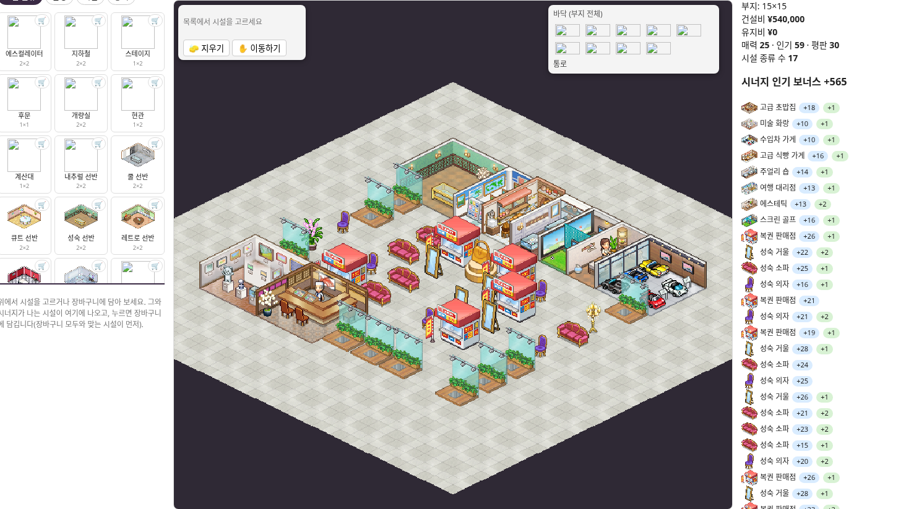
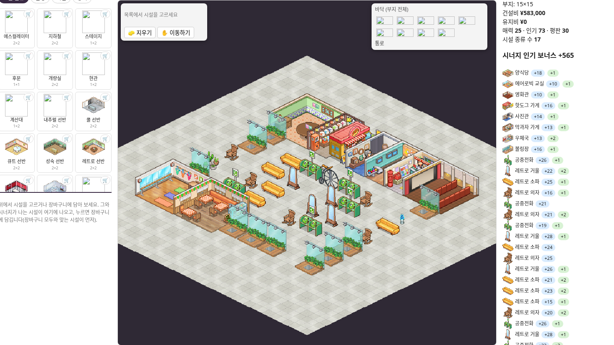
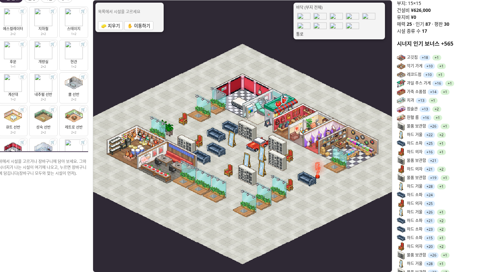
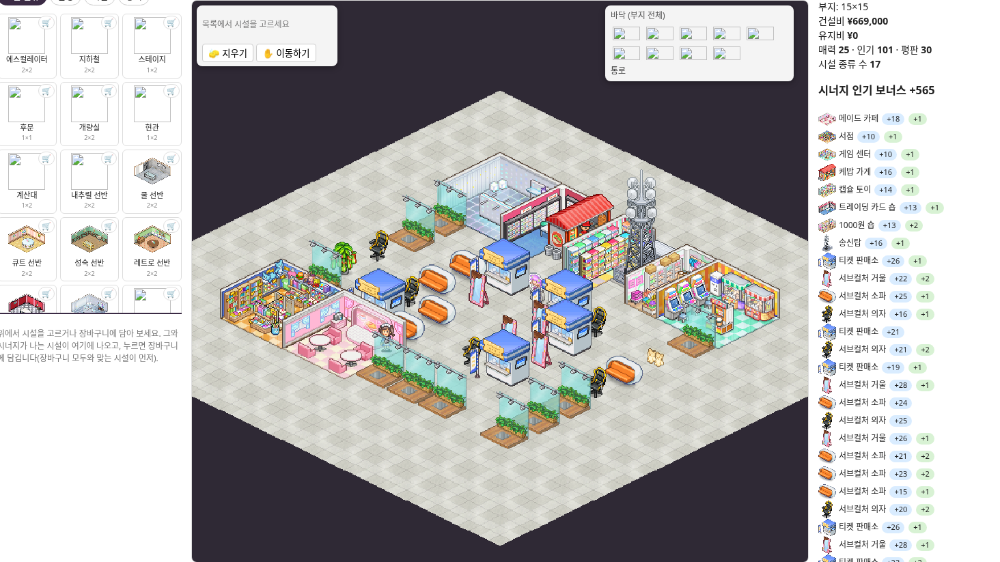

# 인기 우선 · 6개 장르 · 9×9

## 조건

기본 시설 17종은 각각 하나 이상, 마네킹은 총 10개입니다. 장식은 제한 없이 추가하고, 장식 외 1×1 이용 시설은 종류별 총 5개까지 허용했습니다. 마네킹 위치는 자유입니다. 모든 시설이 9×9 내부에서 외곽으로 연결된 단일 통로에 면하도록 검사했습니다.

전체 인기 합계(기본 인기 + 장르 및 장식 시너지)를 목표로 확률적 탐색을 했습니다. **탐색 중 찾은 최고 후보이며, 수학적으로 증명한 전역 최적해는 아닙니다.** 처음의 통로 골격도 변경했습니다. 시설의 입구 방향은 별도로 고정하지 않고 어느 한 면이 통로와 맞닿으면 허용했습니다.

## 가져오기

[공식 배치 빌더](https://kairo.waterbeetles.dev/ko/fashion-mall-story/layout)의 가져오기에서 `optimized-six-all.json`을 선택한 뒤 원하는 안을 불러오세요. 기존 작업은 먼저 내보내기로 보관해 주세요. 대지는 15×15로 표시되지만 시설은 중앙 9×9에만 있습니다.

## 비교

| 장르 | 이전 정돈형 합계 | 이번 합계 | 시너지 | 시설 수 | 통로 칸 |
|---|---:|---:|---:|---:|---:|
| 쿨 | 144 | 596 | +565 | 41 | 23 |
| 큐트 | 154 | 610 | +565 | 41 | 23 |
| 성숙 | 164 | 624 | +565 | 41 | 23 |
| 레트로 | 174 | 638 | +565 | 41 | 23 |
| 하드 | 184 | 652 | +565 | 41 | 23 |
| 서브컬처 | 194 | 666 | +565 | 41 | 23 |

## 쿨

추가 시설: 자판기 4개, 쿨 의자 4개, 쿨 거울 3개, 쿨 소파 4개

## 큐트

추가 시설: 옷 수선집 4개, 큐트 의자 4개, 큐트 거울 3개, 큐트 소파 4개

## 성숙

추가 시설: 복권 판매점 4개, 성숙 의자 4개, 성숙 거울 3개, 성숙 소파 4개

## 레트로

추가 시설: 공중전화 4개, 레트로 의자 4개, 레트로 거울 3개, 레트로 소파 4개

## 하드

추가 시설: 물품 보관함 4개, 하드 의자 4개, 하드 거울 3개, 하드 소파 4개

## 서브컬처

추가 시설: 티켓 판매소 4개, 서브컬처 의자 4개, 서브컬처 거울 3개, 서브컬처 소파 4개

## 검증과 출처

겹침·9×9 경계·통로 연결·전 시설 접근성·마네킹 10개·1×1 이용 시설 종류별 상한을 검사했습니다. 실제 빌더에서 6개 파일 가져오기와 각 안의 시너지 확인, 재내보내기 일치까지 확인했습니다. 게임 내 실측 수치가 아닌 빌더 규칙에 따른 추정입니다.

배치 데이터와 미리보기 출처: [KairoHistory](https://kairo.waterbeetles.dev/ko/fashion-mall-story/). 게임 그래픽 권리: Kairosoft 등 원권리자. 비공식 배치 자료입니다.
