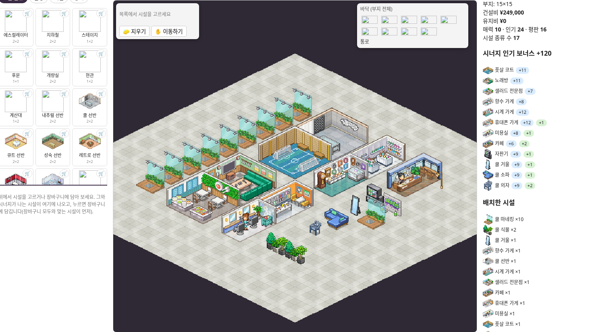
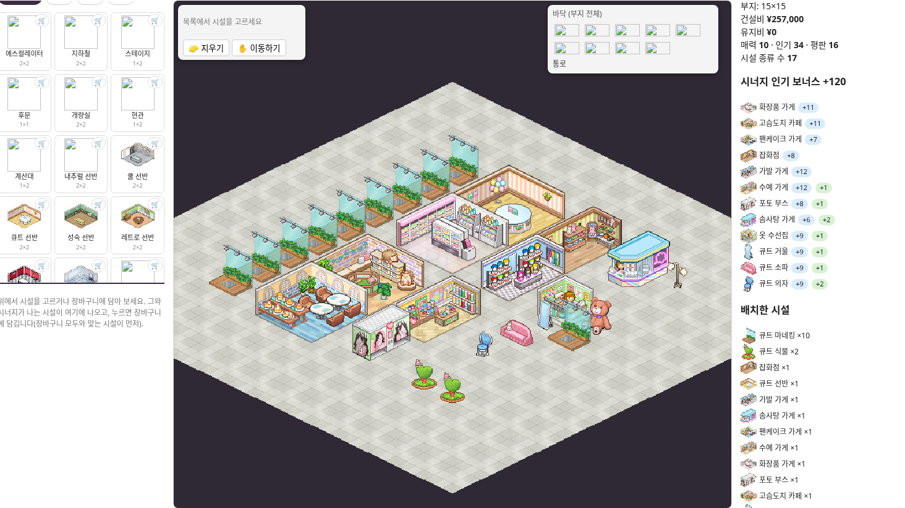
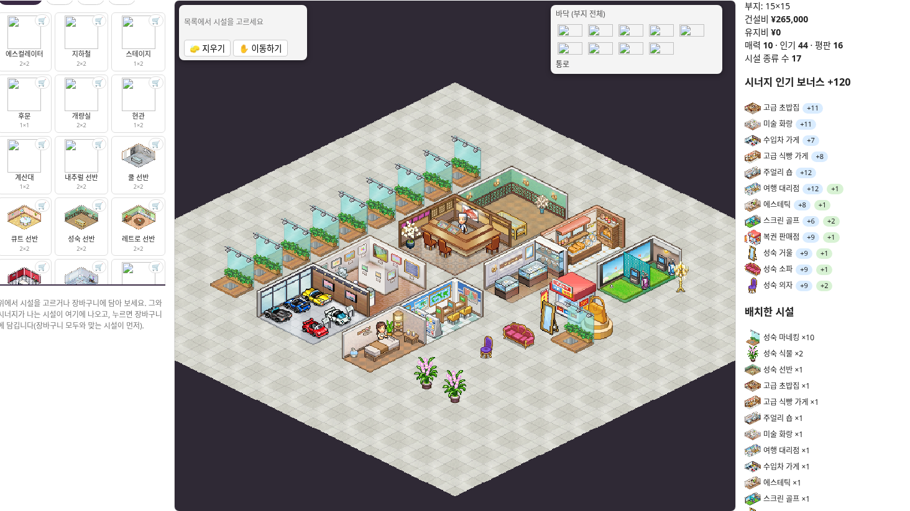
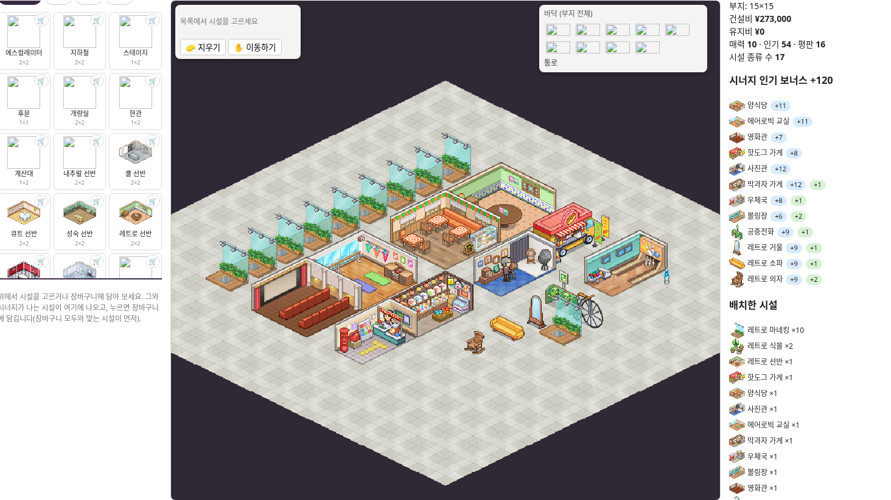
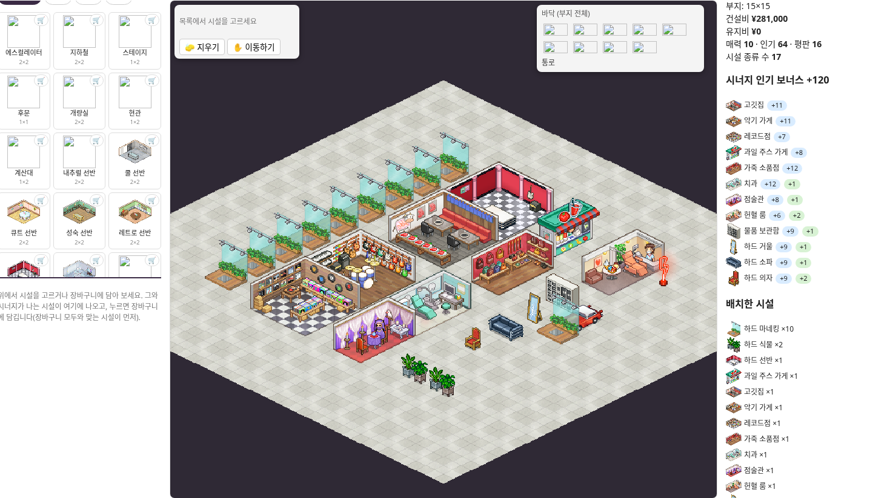
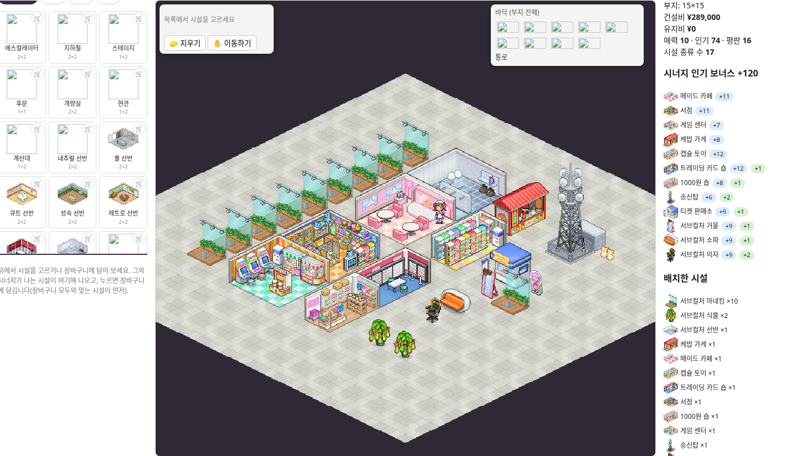

# 나머지 6개 장르 · 마네킹 총 10개 · 9×9

쿨·큐트·성숙·레트로·하드·서브컬처의 배치 파일입니다.

## 가져오기

[배치 빌더](https://kairo.waterbeetles.dev/ko/fashion-mall-story/layout)의 **가져오기**에서 `six-genres-all.json`을 선택하면 여섯 안이 저장 목록에 추가됩니다. 원하는 장르의 **불러오기**를 누르세요. 개별 JSON도 함께 제공합니다. 기존 작업은 먼저 내보내기로 보관해 주세요.

## 공통 조건

- 각 장르 기본 시설 17종을 하나씩 포함합니다.
- 마네킹은 기존 1개에 9개를 추가해 **총 10개**입니다.
- **마네킹 9개가 외곽 한 변에 일렬**로 서며, 나머지 1개는 안쪽에 둡니다.
- 장르에 맞는 식물을 1개 더 추가했습니다. 시설 총 27개, 점유 44칸, 통로 37칸입니다.
- 모든 시설이 외곽으로 연결된 하나의 통로에 적어도 한 면을 접합니다. 마네킹과 장식도 검사했습니다.
- 빌더의 대지는 15×15로 표시되며, 시설은 중앙 9×9 영역에만 배치했습니다.

외곽 진열과 정돈된 통로를 우선한 비교안입니다. 전역 최고 점수 배치가 아닙니다. 여섯 안 모두 실제 빌더의 시너지 **+120**을 확인했습니다. 시설 수·크기·장르 및 장식 보너스 구조가 동일해 시너지 값도 같습니다.

실제 가져오기 → 각 안 불러오기 → 시너지 확인 → 다시 내보내기를 검증했고, 원본 데이터와 동일했습니다. 검증 기록은 `import-test.json`입니다.

## 실제 빌더 미리보기

### 쿨

### 큐트

### 성숙

### 레트로

### 하드

### 서브컬처

출처: [KairoHistory 패션몰 스토리](https://kairo.waterbeetles.dev/ko/fashion-mall-story/). 게임과 그래픽 권리는 Kairosoft 등 원권리자에게 있습니다. 비공식 배치 비교 자료입니다.
