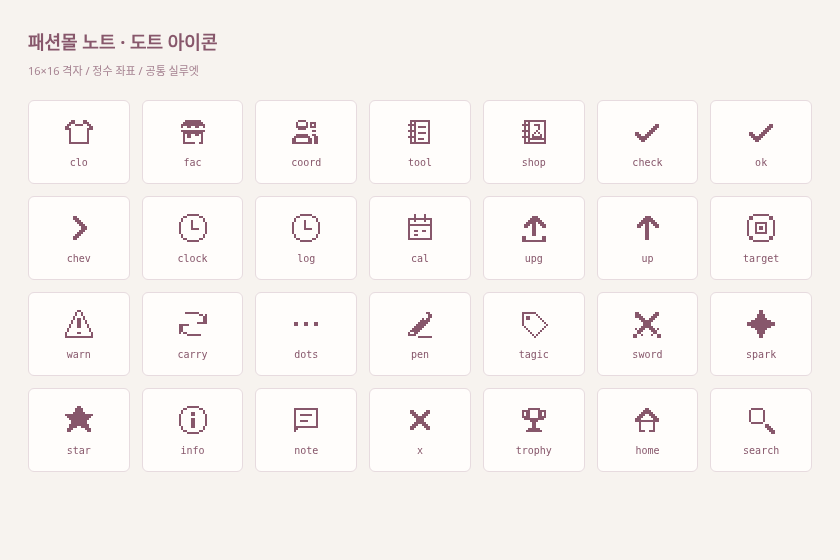
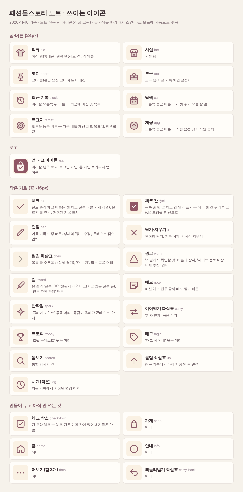

# 그래픽을 도트 스타일로 통일

2026-11-10. 기존 화면·색상·간격·글씨·동작은 유지하고 그래픽만 정리했다.

- 공통 아이콘 28종은 직접 그린 16×16 정수 격자로 통일했다. 곡선 스트로크 대신 픽셀 면을 사용하며 `crispEdges`로 표시한다.
- 의류·시설·코디·도구, 체크·수정·닫기·화살표·경고·최근 기록·리셋 주기·목표치·개량 아이콘에 적용한다.
- 전투 태그 안의 시스템 이모지도 같은 도트 칼 아이콘으로 바꿨다.
- 대표 아이콘은 기존 노트·옷걸이를 유지한 64×64 도트 원본으로 다시 제작했다. 작은 파비콘은 별도 16×16 원본이다.
- 32·180·192·512px PNG와 maskable 아이콘을 교체하고, 파비콘·홈 화면 링크·매니페스트에 캐시 버전을 붙였다.

[휴대폰](screenshots/pixel-icons/phone.png) · [아이패드](screenshots/pixel-icons/ipad.png)

아이콘은 `app/src/ui/pixel-icons.ts`, 대표 아이콘 원본은 `app/public/icons/app.svg`, 작은 원본은 `app/public/icons/favicon.svg`에 있다. 게임 원본 이미지 수집이나 DB 필드는 필요 없다.

검증: 네 개 탭의 실제 표시 SVG가 도트 아이콘인지 검사했고, 320·390·768·834·1440px 가로 넘침과 PNG 크기·캐시 버전을 확인했다. 기존 Playwright 21개와 미리보기·운영 빌드도 통과했다. 기존 홈 화면 아이콘은 OS 캐시 때문에 다시 추가해야 새 그림으로 바뀔 수 있다.

## 더스티 로즈 아이콘 묶음 B로 교체 (2026-11-10)

제제가 준 아이콘 묶음(B soft outline)으로 바꿨다. 위의 단색 SVG 중 아래 8개와 대표 아이콘·파비콘만 바뀌고, 체크·연필·화살표 같은 작은 기호는 SVG 그대로다.

- 탭(의류 `clo`·시설 `fac`·코디 `coord`·도구 `tool`), 최근 기록 `clock`, 오른쪽 버튼(달력 `cal`·목표치 `target`·개량 `upg`): `app/public/icons/ui/{이름}-{16|24|32}.png`. 화면에는 24px 원본 그대로 쓴다(아이폰 3배·패드 2배에서 정수 배율).
- 머리줄 로고와 로그인 화면: `app-128.png`(64px 격자 2배)를 32~36px, 64px로 표시.
- 파비콘 `favicon.ico`·`favicon-16/32.png`, 홈 화면 `apple-touch-icon.png`, 매니페스트 `app-192/512`·`app-maskable-512`. 캐시 버전은 `?v=rose-1`. 예전 `app.svg`·`favicon.svg`는 지움.
- 코드: `app/src/ui/pixel-icons.ts`의 `pngIcon`, 크기는 `design-system.css` 맨 아래.

전체 아이콘 이름·쓰이는 곳: 

## 소프트 플랫 부티크 묶음으로 전부 교체 (2026-11-10)
- 제제가 준 `fashion-mall-story-note-soft-flat-boutique.zip`의 28종을 탭·버튼·작은 기호 전부에 적용. 도트 SVG와 로즈 도트 PNG는 뺐다.
- SVG 도형은 `app/src/ui/flat-icons.ts`에 넣어 문서 안에 바로 그린다. 색은 CSS 변수 `--ic-ln`(선), `--ic-soft`(옅은 면), `--ic-fill`(진한 면)로 칠하고, 다크 모드는 밝은 로즈로 자동 전환한다(design-system.css).
- 체크 칸 안 표시는 색이 찬 칸 위라 ok 모양을 흰 선으로 쓴다.
- 원본 파일(라이트·다크 SVG, PNG 16·24·32·48)은 `app/public/icons/ui/{light,dark}/`에 있다. 앱 대표 아이콘·파비콘도 묶음 것으로 교체했고, 로고는 라이트·다크 두 벌 중 하나만 보인다.
- 목록 이미지: [screenshots/icon-list.png](screenshots/icon-list.png)

## 직접 그린 선 아이콘으로 교체 (2026-11-10)
- 제제가 묶음 아이콘과 비교해 보고 직접 그린 쪽으로 결정. 28종 전부 `app/src/ui/line-icons.ts`.
- 24칸 격자, 선 1.75, 둥근 끝. 선은 글자색(currentColor)을 따라가고, 탭 아이콘 등 몇 개만 같은 색 16% 옅은 면을 깐다 → 스킨·메인 색상·다크 모드에 자동으로 맞는다.
- 그림이 바뀐 것: 코디=마네킹, 최근 기록=되감기 시계, 개량=동그라미 속 위 화살표, 회차 연계=엇갈린 화살표, 칼=한 자루.
- 앱 대표 아이콘·파비콘은 소프트 플랫 부티크 묶음 그대로.
- 묶음 아이콘으로 되돌리려면 `app/src/ui/pixel-icons.ts`의 `SET`을 `"pack"`으로.
- 요청서(이름·용도·색상): [icon-brief.md](icon-brief.md), 목록 이미지: [screenshots/icon-list.png](screenshots/icon-list.png)

## 앱 대표 아이콘·파비콘 새로 그림, 체크 칸 색 (2026-11-10)
- 빈티지 로즈(#905665) 둥근 네모 + 크림색(#FBF4EF) 쇼핑백 + 로즈 체크. 16~32px 파비콘은 선을 굵게 따로 그렸다.
- 파일: app/public/icons/ (app·favicon·apple-touch·maskable, light/dark 폴더도 같은 그림). 원본 SVG는 app.svg, favicon.svg.
- 목록 줄 체크 칸(.ck.on)은 초록 대신 메인 색상(--blue, 로즈 팔레트면 로즈)으로. 체크 선은 카드색.
