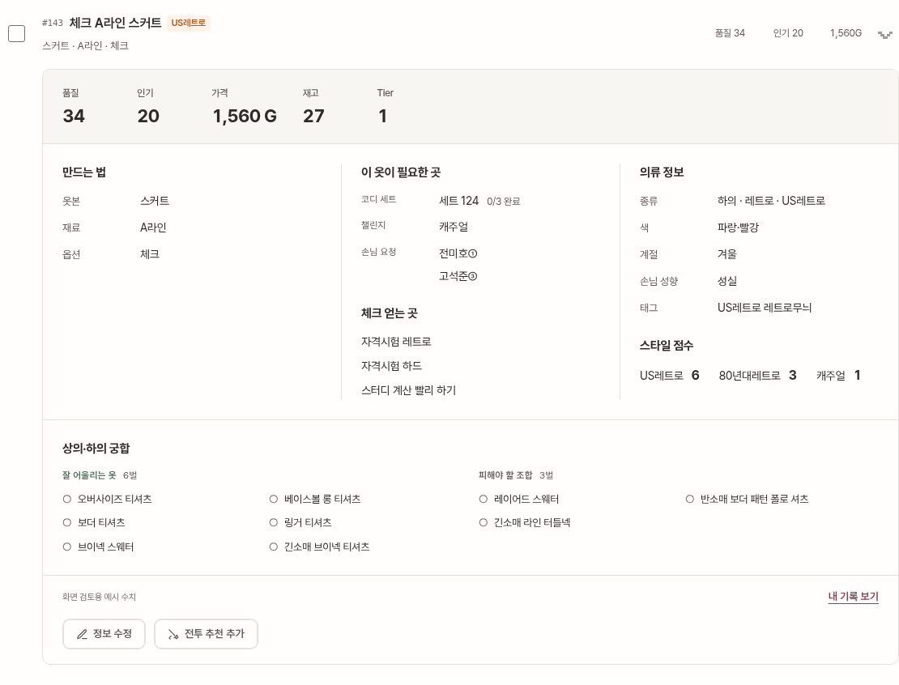
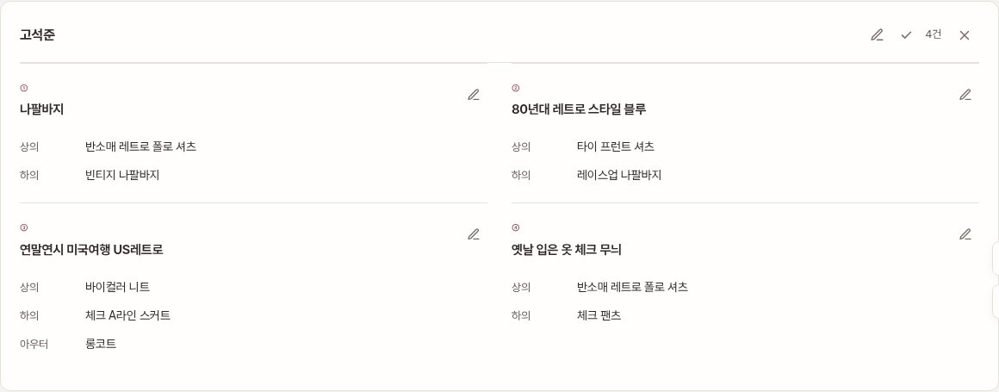
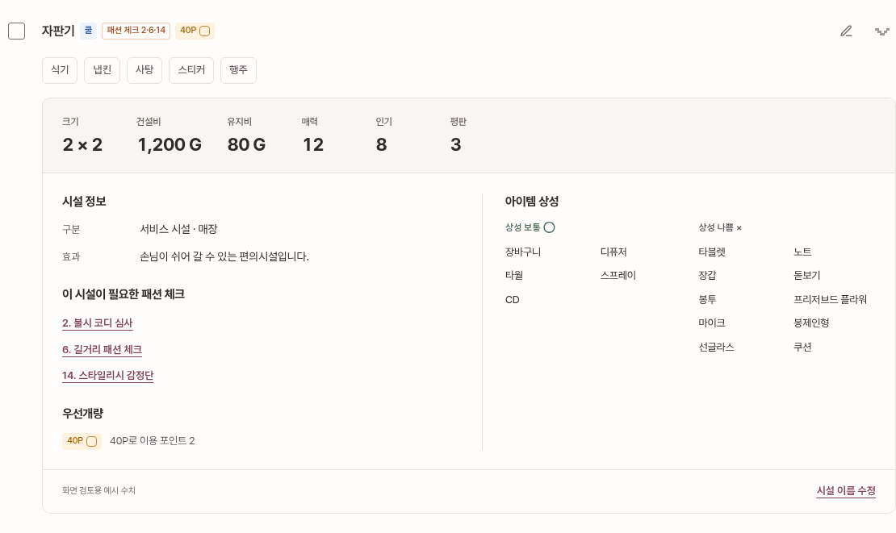
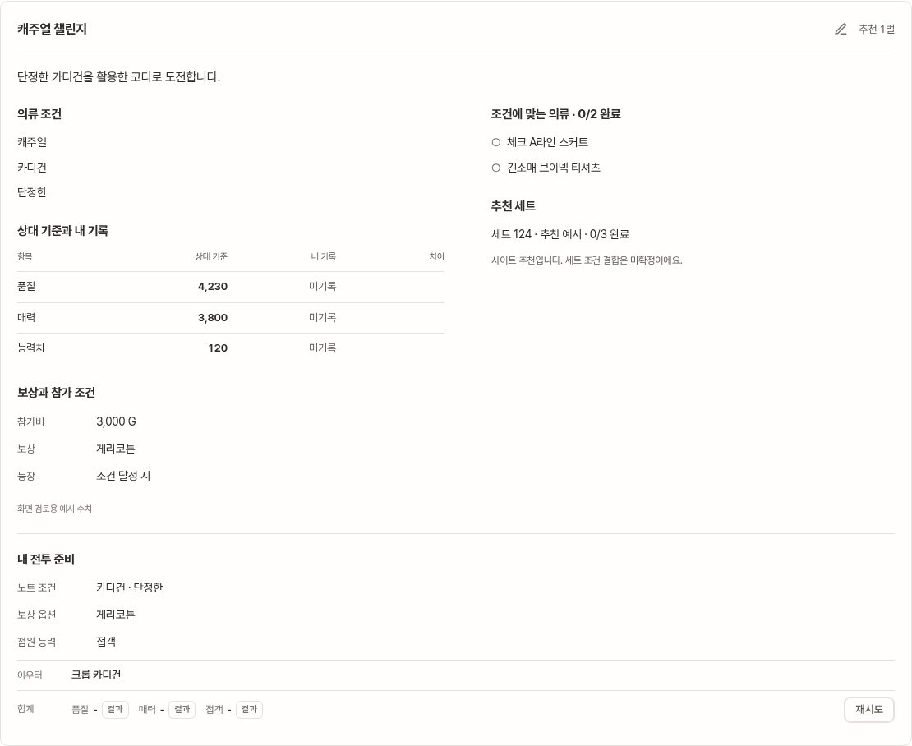

# 한 화면에서 비교하는 정보 구조

2026-11-09. 목적은 위키의 내용을 다시 나열하는 것이 아니라, 내 진행과 필요한 공략을
함께 확인하고 완료·수정을 바로 처리하는 것이다.

## 표현 원칙

- 주요 수치는 상단에 모은다. 항목명과 숫자의 크기·무게를 구분한다.
- 만드는 법, 활용처, 속성, 궁합은 제목이 있는 묶음으로 구분한다.
- 읽기 전용 값은 버튼 모양 태그 대신 항목–값과 목록으로 표시한다.
- 선택 칩·체크·실행 버튼에만 조작 가능한 표현을 쓴다.
- 재료·손님 요청·세트 진행·궁합 등 비교가 잦은 정보는 기본으로 펼친다.
- 기록·기존 메모 같은 보조 정보만 별도로 펼친다. 화면 갱신 시 펼침 상태를 유지한다.
- 도트는 브랜드와 공통 아이콘에 남기고, 작업 본문은 읽기 쉬운 서체로 통일한다.
- 넓은 화면에서는 명시적으로 묶은 열을 비교하고, 모바일에서는 같은 순서로 읽는다.

## 적용 화면

의류 상세는 수치 → 제작/활용/속성 → 궁합 → 기록/수정 순서다.
시설 상세는 수치, 시설 정보·연결된 패션 체크, 아이템 상성을 함께 표시한다.
손님 코디는 요청별 제목과 부위별 옷 목록으로 정리하며, 한 손님의 여러 요청도 넓은
화면에서 2열로 비교한다. 배틀은 조건, 상대 기준/내 기록/차이, 보상, 일치 의류를
구분한다. 패션 체크와 자료는 필드 이름을 정렬해 읽는다.

공통 정보 컴포넌트는 `app/src/ui/information.js`, 스타일은
`app/src/styles/pixel-diary.css`에서 관리한다. 이전 `components.css`는 제거했다.
Firestore 경로·수치 계산·기준 데이터·사용자 수정값 우선순위는 바꾸지 않았다.

## 화면 검토용 예시

`preview-fixture.ts`는 비어 있는 초기 화면만 보고 검토하는 문제를 피하기 위해,
일부 의류·시설·세트·배틀·자료에 정보량이 많은 예시를 넣는다.
운영 빌드에는 포함하지 않고 실제 Firestore에도 쓰지 않는다. 미리보기 배너와
예시 상세 하단에 이를 명시한다. 아래 이미지는 이 검토 환경을 캡처한 것이다.

| 의류 상세 | 손님 코디 |
|---|---|
|  |  |

| 시설 상세 | 배틀 |
|---|---|
|  |  |

[모바일 의류 상세](screenshots/readable-mobile.png) · [자료](screenshots/readable-reference.png)

## 검증

운영/미리보기 빌드와 Chromium 기능 테스트를 사용한다. 기존 체크·필터·검색·테마·탭
전환 외에 정보가 많은 상세, 수정 저장, 시설, 손님 요청, 배틀과 편집창을
320/390/768/1440px에서 확인한다. 실제 계정 로그인·기기 간 동기화와 iPhone
Safari 실기기 확인은 별도다.
