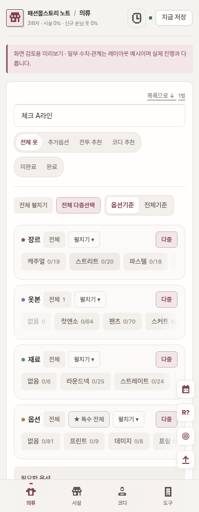
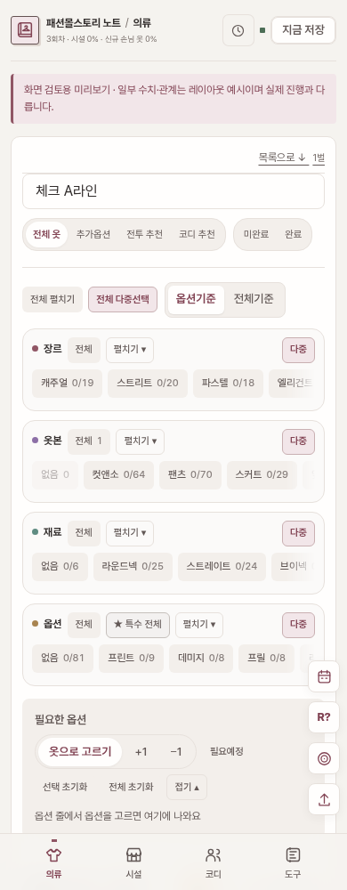

# 기존 디자인의 간격·글씨·아이콘 정리

2026-11-10. main `2b9c8eb` 기준. 메뉴·필터·정보 순서·데이터·저장 로직·색상과 기존 디자인 선택은 유지한다.

- 휴대폰·패드에서 카드 안쪽과 필터 줄 사이 여백을 줄였다. 휴대폰 보기/상태 버튼도 더 자연스럽게 한 줄에 들어간다.
- 목록 제목 12.5~13px, 설명 11~11.5px, 상세 본문 12px로 위계를 정리했다. 긴 제목과 상세 값이 좁은 열 안에서 줄바꿈되도록 했다.
- 휴대폰 입력창은 16px로 두어 iPhone Safari의 입력 시 자동 확대를 방지한다. 필터·체크 버튼은 누르는 영역을 유지한다.
- 작은 크기에서 뭉치던 16px 픽셀 아이콘을 공통 24px 격자의 라인 아이콘으로 바꿨다. 선 굵기·끝·모서리를 통일하고, 메뉴·체크·수정·경고·최근 기록·빠른 보기에 함께 적용한다.
- 노트와 옷걸이를 결합한 대표 아이콘을 만들었다. SVG 파비콘과 32px PNG, iOS 180px, Android 192/512px, 별도 maskable 512px를 연결했다.
- 웹 매니페스트는 GitHub Pages 하위 경로를 기준으로 시작 주소와 아이콘을 읽는다. 서비스 워커나 별도 오프라인 저장 기능은 추가하지 않았다.

## 대표 아이콘

원본: [앱 SVG](../app/public/icons/app.svg), [작은 파비콘 SVG](../app/public/icons/favicon.svg).

## 휴대폰

| 조정 전 | 조정 후 |
|---|---|
|  |  |

[아이패드 화면](screenshots/responsive-polish/ipad-after.png). 화면 검토용 데이터로 캡처했다.

## 검증

기존 Playwright 21개 검사와 미리보기·운영 빌드를 통과했다. 320·390·768·834·1024·1440px에서 의류 목록과 상세의 가로 넘침을 확인했다. 기존 검사로 시설·코디·도구·편집창·디자인 전환·다크 모드의 기능도 확인했다. 매니페스트의 하위 경로, 아이콘 HTTP 응답 및 PNG 크기, 모바일 검색창 16px, 메뉴 네 개의 새 SVG 적용을 별도로 검사했다.

실제 iOS 홈 화면 등록과 Safari 실기기 확인은 별도로 필요하다. 이미 등록한 홈 화면 아이콘은 OS 캐시 때문에 즉시 바뀌지 않을 수 있다.
